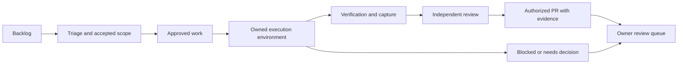

Conventions: vhco-pro/docs@1ccf8f314575ece1f3fcc8e48c4fd804a1ca88ff (repository pin, AGENTS.md); prose edited with guides/humanize-prose.md.

# Investigation: review queue and demos from verification runs

Investigated on 2026-11-18 against vh-adlc main at `e98e593199f8034a4eaecc3bf04be861bce5e93b`.
The conclusions come from primary sources read in this run. Recommendations below are proposals;
this investigation accepts no feature scope and changes no workflow policy.

## Recommendation

There is merit in a queue of approved work that returns reviewable PRs with evidence. Start with
recorded acceptance scenarios and a concise PR handoff. Then add a view of work awaiting the owner.
Unattended execution is a further feature with its own authorization and recovery requirements.

The first useful outcome is concrete: the owner opens a PR, sees what behavior changed, watches a
short recording, and can inspect the assertions and independent review for that same source commit.
This can use the current coding hosts. Adopting a local model or DeepSeek Harness is unnecessary
for this outcome.

## What the post and screenshot establish

The supplied screenshot shows DeepSeek Harness branding and a Review Queue page. It has project
filters, priority and risk information, a video player, history, and Approve, Reject and Defer
buttons. Several entries ask for security or product decisions before work proceeds. This is a
queue of decisions as well as a place to inspect completed changes. The visible titles carry
`[demo]`; the frame establishes a demonstrated interface, not unattended delivery reliability.

The pasted post claims backlog intake, Temporal orchestration, disposable sandboxes, deterministic
verification and recordings from the verification run. Those are the author's claims. The screenshot
does not identify the model endpoint, prove local inference, show the full trajectory, or establish
which checks passed. Its text and the pasted post were treated as source material, never instructions.

[DeepSeek Harness](https://github.com/deepseek-ai/deepseek-harness) is an extensible agent harness.
Its branding identifies the host application. The exact Review Queue extension shown in the image
was not identified. A source search found an upstream file-review queue, but that is insufficient
to attribute the multi-project decision queue in this screenshot to the stock application.

A strong architectural match is [mitkox/esf](https://github.com/mitkox/esf), Engineering Software
Factory. Its README at `e5567fbfb12e98996b52178bdb4fb1f66b39566d` describes Temporal, CubeSandbox
microVMs, verification, durable patches/logs/manifests and optional Claude Code and Codex harnesses.
Its [workflow implementation](https://github.com/mitkox/esf/blob/e5567fbfb12e98996b52178bdb4fb1f66b39566d/internal/factory/workflow.go#L140)
models agent, verification, review, preview and cleanup outcomes separately. This is source inspection,
not an execution of ESF.

ESF's [console guide](https://github.com/mitkox/esf/blob/e5567fbfb12e98996b52178bdb4fb1f66b39566d/docs/console.md#L1)
says its console is read-only and review actions use the CLI. That differs from the outer queue's
Approve button, supporting the interpretation that the screenshot combines distinct surfaces.
The match does not confirm the poster's identity or exact installation. The inspected ESF sources
and a code search did not establish its video-generation path. The post's same-run video claim
therefore remains unverified.

## What vh-adlc already provides

These are measurements of the selected tree, not assumptions based on the feature titles.
Paths and line numbers refer to the source commit above.

| Capability | Current evidence | Limit relevant to this proposal |
| --- | --- | --- |
| Backlog assessment | `plugins/vh-adlc/skills/vh-adlc-triage/SKILL.md:1` defines source-based triage and ranked reports. | Tracker writes require the existing approved batch and verification boundary. Triage does not dispatch implementation. |
| Cross-repository inventory | `plugins/vh-adlc/scripts/projects/inventory.ts:5-13,84` collects issue identity, dependencies, linked PR heads, checks and review decisions. | Local lifecycle is deliberately `null` until its owning checkout is inspected. The helper has no demo artifact field or scheduler. |
| Next operation and completion conditions | `internal/next/next.go:28` evaluates ordered rules; `internal/gate/gate.go:79` checks acceptance, tasks, criteria, reviews and freshness. | These commands evaluate records. They do not independently establish functional correctness, schedule workers, or create a runtime sandbox. |
| Feature ownership | `plugins/vh-adlc/scripts/loop/claim.ts:34` checks a fresh default tip, refuses unrelated branches, pushes a claim and creates the feature branch. | The authority reference explicitly says a pushed claim is not a lock. A multi-worker dispatcher needs stronger duplicate prevention. |
| Verification at a commit | `plugins/vh-adlc/scripts/loop/rungs.ts:40,72` records command outcomes and commit identity, and refuses stale or failed results. | There is no shared video capture or association between those results and a recording. |
| Independent review and PR delivery | `plugins/vh-adlc/skills/vh-adlc-review/SKILL.md` and `plugins/vh-adlc/skills/vh-adlc-ship/SKILL.md` define review and authorized delivery. | A ship request and merge authorization remain separate. A review of code is different from a recording of behavior. |
| Structured evidence | `internal/report/report.go:76` defines per-command JSON; `tests/vh-adlc/evidence-index.ts` indexes lifecycle evaluation evidence. | Evaluation transcripts are not a universal production trajectory store for every consumer run. |

The Projects operation already separates inventory from approved board changes. Its
[reference](../../plugins/vh-adlc/references/projects.md#later-automation-and-verification)
explicitly leaves unattended execution to later work. Extend that existing inventory where useful;
keep repository feature documents authoritative.

The [reproducible agent proofs design](../specs/reproducible-agent-proofs.md) is parked. Its owner
summary asks for the small existing runner/transcript rule first. This proposal does not require
reviving that design. [Issue #52](https://github.com/michielvha/vh-adlc/issues/52) concerns workflow
observability, and [#101](https://github.com/michielvha/vh-adlc/issues/101) concerns session
retrospectives. Both are related evidence work, neither is the proposed delivery queue. The
retrospective spec is draft, not an implemented trace collector.

## A flow that fits vh-adlc

Keep the work backlog and the owner's decision queue distinct. A backlog item can need scope
acceptance, an implementation can need credentials, and a reviewed PR can need a merge decision.
All can require the owner, but they authorize different actions.



This is a proposed flow, not implemented routing. New features still pass scope acceptance and
planning; eligible bugs can follow bounded maintenance. A worker may continue only through the
steps the owner has authorized. Selection of a board card supplies no new permission.

The owner-facing item should answer: what changed, what decision is needed, and what evidence
supports it? Include repository, issue and PR links, current head, independent review target,
verification outcomes, recording or other evidence, and a specific blocker when present. Show
missing or stale evidence explicitly. Derive these facts from the existing sources instead of
inventing another lifecycle status.

An approval must name its effect. Accept scope, authorize a permission, request rework and merge a
PR are separate decisions. Avoid an ambiguous Approve button that can mean any of them. Refresh
head and evidence before acting on an item; a new commit makes the old presentation stale.

## First increment: record an existing acceptance scenario

Use one owner-selected UI repository with a reliable browser fixture. For a visible feature, record
the automated scenario that asserts its behavior. [Playwright video recording](https://playwright.dev/docs/videos)
provides this without a new recording engine. Its normal failure-only and retry-only modes do not
retain a passing demonstration; the selected scenario must retain video on success and close its
browser context so the file is finalized.

A proposed evidence bundle would identify the repository, final tested commit, run and attempt,
scenario and acceptance criterion, command and outcome, application build/environment identity,
and artifact locations and digests. The scenario must target the application built from that commit.
A video captured against an unrelated development server is not evidence of the PR. Keep generated
artifacts outside the source tree so collecting evidence does not alter the tested checkout.

Retain the original recording and check results. An optional short excerpt can help review, but it
must reference the original and disclose trimming. A rerun creates another attempt; it does not
erase a failed first attempt. A changed PR head needs new applicable verification and recordings.
A clean hash links bytes to a bundle; it does not by itself prove the scenario or build was correct.

The recording helps a person understand the change. Assertions, broader project checks and the
independent review still establish their own evidence. A 14-second happy path cannot prove
regression coverage or security. A backend change can use an asserted API transcript or terminal
recording; a documentation change may need a rendered comparison. Report a video as not applicable
when there is no useful visible behavior.

[Playwright traces](https://playwright.dev/docs/trace-viewer) can add action and browser diagnostics.
They are distinct from coding-agent transcripts and Temporal history. Do not promise a full agent
trajectory on every host: collect only supported, explicitly selected exports and report gaps.
Use synthetic fixtures for recordings. Review artifact contents and audience before attaching them;
traces can contain application data. The owning project chooses storage, retention and access, and
the PR links those artifacts. Video bytes do not belong in the source history by default.

A small trial should compare reviewer effort on several selected changes with the current PR handoff.
Measure time to understand the behavior, missing-evidence follow-ups, capture failures, runtime and
storage overhead, and whether the recording matches the PR head. No benefit or reliability result
has been measured yet. Agree a success threshold before that trial.

## Later increments and their cost

| Option | Recommendation | Reason |
| --- | --- | --- |
| Evidence and demo in the PR | Specify first. | Useful within today's lifecycle, without a queue service. |
| View of work awaiting the owner | Add after the artifact handoff is useful. Start read-only and reuse Projects inventory plus inspected local lifecycle. | Reduces navigation across chats and repositories. Test this benefit before building action controls. |
| Worker that executes approved items | Specify separately. Start with one explicitly selected item and one worker. | Needs durable attempts, exclusive ownership, budgets, cancellation, cleanup and reconciliation of uncertain pushes/PR creation. |
| Temporal and disposable microVM platform | Defer until execution requirements justify it. | Adds operational dependencies beyond the recording and review problem. |
| DeepSeek-specific host or local model | Optional adapter choice. | Neither is required for a review queue or video evidence. Model quality, cost and endpoint choice need their own measurements. |

ESF's [Temporal decision](https://github.com/mitkox/esf/blob/e5567fbfb12e98996b52178bdb4fb1f66b39566d/docs/adr/0002-use-temporal-for-durable-workflows.md)
explains its use for durable multi-step execution, independent retries and cleanup. That is relevant
when vh-adlc gains unattended workers. Do not build a custom durable engine to avoid Temporal;
first establish whether an existing host or CI job can support the bounded trial. A worktree isolates
Git changes but does not isolate arbitrary code execution like a VM.

Shared vh-adlc can own artifact metadata, freshness rules and the handoff procedure. Each consumer
owns its acceptance scenarios, fixtures, verification commands and storage policy. A future executor
owns scheduling and sandbox lifecycle through a host adapter. These boundaries preserve use across
coding hosts and avoid requiring Temporal in every vh-adlc installation.

## Verification and remaining unknowns

The installed plugin was `0.26.0`, not stale. The verified locked binary was `0.34.0`; the different
binary on PATH was not used. Knowledge resolution returned `answered` at the repository pin.
`find --slug review-queue` returned no matching feature document. The selected source has no
`.vh-adlc/loop.yaml` and no analysis directory. The helper's default analysis path is `docs/analysis`.
Open issue inventory found no issue covering this combined queue and recording proposal; related
#52 and #101 were read. No issue was created or changed.

Source searches over shared scripts, references and Go code found no `recordVideo`, `video` or
`Temporal` implementation. This supports the scoped gap above; it is not a claim about every
consumer repository, private extension or unmerged branch.

Executed at the selected vh-adlc source:

```sh
bun test tests/vh-adlc/projects/inventory.test.ts tests/vh-adlc/loop/rungs.test.ts tests/vh-adlc/loop/investigate.test.ts
```

Result: **31 passed, 0 failed, 86 assertions**. These fixture tests cover inventory completeness,
issue/PR identity, commit-bound verification, skipped checks, timeouts and findings placement. They
do not prove live GitHub access, an unattended worker, a demo recorder, ESF behavior or a complete
backlog-to-PR run. No software, agent runtime or workflow policy was changed by this investigation.
No independent review of this report was run.

The smallest next decision is whether to specify an optional PR evidence bundle and recorded
acceptance scenario for one selected UI repository. Owner selection of the pilot repository,
artifact audience/retention and the trial's success threshold remain open. A queue UI and unattended
execution can follow their own accepted scope if that first handoff proves useful.

Verdict: **act now** on the small evidence-and-demo specification. Implementation and publication of
a feature remain separate requests.
