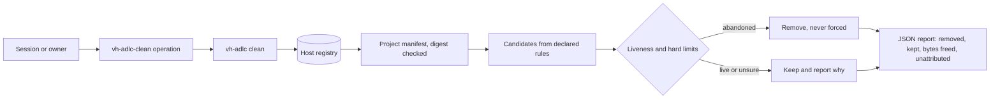

# Plan: Host cleanup

One shared, reviewed way for every project on a workstation to keep its temporary files in a known
place, declare what it owns, and let any agent session remove what killed runs left behind. The
`vh-adlc` binary gains `env`, `clean` and `host` commands, the plugin gains a `vh-adlc-clean`
operation, and the owner adds one allow rule per harness so sessions stop getting blocked.

## Context

### What accumulates on this host

The owner reported on 2026-11-02 that the user's `/tmp` quota filled and blocked every session. The
measurements below were taken on host `fedora-43` the same day.

- `df -h /tmp` shows a 16G tmpfs; `quota -s` shows user `m` at 9252M of a 12815M limit on it.
  `ls /tmp | wc -l` returned 4152 entries, and `find /tmp -maxdepth 1 ! -user 1000` found 15 that
  belong to other users.
- The largest entries (`du -s --block-size=1M /tmp/*`) are two
  `TestConformance_InProcessAndContainerReportTheSame*` directories of 454 MB each, which are
  `t.TempDir` leftovers of Stackweaver's
  `backend/internal/launcher/driver/conformance_integration_test.go:276` (branch
  `feat/runner-architecture` at `27f37a72`). Next come 22 `go-build*` directories (the three largest are
  145, 134 and 108 MB), seven `stackweaver-visuals-*` directories, the largest about 94 MB each,
  from `refresh()` in Stackweaver `scripts/docs-visuals/index.js:92` (`origin/main` at `50656333`), and other projects'
  entries such as `crossplane-docs-tools` (279 MB) and `stack-triage-rehearsal-OFjwII` (175 MB).
- vh-adlc leaks too: 74 `vh-triage-verification-<pid>` and 31 `vh-triage-locks-<pid>` entries come from
  `tests/vh-adlc/triage/fixtures.ts:4-5`, and `plugins/vh-adlc/scripts/ensure-vh-adlc.sh:109` creates
  `vh-adlc-ensure.*` under `${TMPDIR:-/tmp}`.
- Some user-owned entries are live and belong to no project: `claude-1000` (195 MB, Claude Code's
  session scratch), `containerd-mount4255318160`, `node-compile-cache` and `gopls-tempmod*`.
- Projects already pick their own temp roots under `~/.cache`: `gotmp` (393 MB), `sw-p6`, `sw-p8`,
  `sw-agent-a6bdb-gotmp` (167 MB) and 19 `sw-runner-arch-*` entries (`ls ~/.cache`, `du -sh`). A live
  Stackweaver test binary, pid 461166, ran for 43 minutes from
  `/home/m/.cache/sw-p8/tmp/go-build2963207335/b001/driver.test` (`ps -o pid,user,etime,cmd -p 461166`).
  `df -h ~/.cache` shows `/home` at 96% with 9.4G free.

Docker is one rootful engine shared by every project: `docker context ls` shows
`unix:///var/run/docker.sock`, and `docker info` reports server 29.7.2 with no rootless option.
`docker system df` reported 300 images (84.66GB, 61.81GB reclaimable), 86 containers, 68 volumes
(25.62GB, 16.7GB reclaimable) and 27.73GB of build cache. 45 of the 68 volumes are anonymous: their names
are 64 hex characters and their only label is `com.docker.volume.anonymous`.

- A live run's resources carry an ownership mark. `sw-test-db-87d6380a` and its siblings carry
  `sh.stackweaver.test-run=fedora-43/461166`, the pid above, which was still running.
- Older networks `sw-test-jobs-5f77d912` and `sw-test-jobs-b4d91316` carry `sh.stackweaver.managed=true`
  but no `test-run` mark, so nothing records which run made them.
- Compose slot stacks record their checkout. The `swc-6-*` containers carry
  `com.docker.compose.project.working_dir=/home/m/code/stackweaver/.claude/worktrees/agent-a6bdb414ef2821af6/deploy`
  (`docker inspect swc-6-api`), and that worktree still exists.
- Stackweaver's main dev stack is Compose project `deploy` (network `deploy_stackweaver`). Stackweaver
  treats its database as production with no backup (Stackweaver `CLAUDE.md:144`).
- Other tools leave containers no project label identifies: 30 containers with random names and only
  `io.crossplane.xpkg:*` labels, 29 of them exited (`docker ps -a`).
- `~/go/bin/kind get clusters` returned "No kind clusters found". Stackweaver's harness names its
  cluster `sw-e2e` (`e2e/k8s/run.sh:14`) and deletes it from an `EXIT` trap unless `KEEP_CLUSTER=1`
  (`e2e/k8s/run.sh:46,55`); a SIGKILL skips the trap. The 19 orphan networks the owner reported from
  another tool were no longer in `docker network ls`.

Stackweaver's launcher programs one host firewall chain pair per jobs network, `SW-JOBS-<8 hex>` and
`SW-JOBS-<8 hex>-IN` (`backend/internal/launcher/driver/network.go:109`, `chainName`). It writes them from
a one-shot container on the host network with `NET_ADMIN`, running as uid 0 (`runFirewall`,
`network.go:212,221`). Removing a network does not remove its chains. Listing or removing chains needs the
same privilege, so this draft did not measure how many remain.

### Prior art in Stackweaver

`sweepEndedRuns` (`backend/internal/launcher/driver/leftovers_integration_test.go:81`, `27f37a72`)
already does this job for one package. Every resource that package's integration tests create carries
`sh.stackweaver.test-run=<host>/<pid>` (`:27`). `runEnded` (`:64`) calls a mark ended only when the host
matches and `kill(pid, 0)` returns `ESRCH`. The sweep removes containers, then the firewall chains of
their jobs networks (`:144`, using the ended run's own `sw-tools-*` image), then networks, volumes and
images. It never forces a removal, because Podman's forced removal also removes the containers using the
object (`:78-80`). `used` (`:190`) treats a failed listing as in use. The sweep runs only in that
package's `TestMain`, so it misses leftovers of other packages, scripts and harnesses.

Stackweaver's `scripts/agent-slot.sh` keeps slot locks in `/tmp/stackweaver-slots` (`:33`), and its `gc`
(`:394`) reclaims slot databases whose worktree is gone.

### Why sessions cannot clean up today

The owner reported that the auto-mode classifier refuses to sweep shared `/tmp`, remove anonymous
volumes or run a broad `pkill`, because it cannot tell one project's files from another's, and that an
agent may not grant itself an allow rule. Claude Code's documentation confirms the route around this:
an action that matches an allow rule resolves before the classifier sees it, and on entering auto mode
only broad rules (blanket `Bash(*)`, wildcarded interpreters, package-manager run commands) are dropped,
while narrow rules stay. Codex resolves commands against `prefix_rule` entries in
`~/.codex/rules/*.rules`. With codex-cli 0.163.0,
`codex execpolicy check --pretty --rules <file> -- vh-adlc clean --dry-run` against
`prefix_rule(pattern=["vh-adlc", "clean"], decision="allow")` returned `"decision": "allow"`, and
`vh-adlc host register .` matched no rule. Claude Code here is 2.1.309 (`claude --version`).

### The vh-adlc binary and plugin today

- Every command is about feature documents: `knowledge`, `find`, `lint`, `gate`, `fresh`, `next` and
  `review check` (`cmd/vh-adlc/main.go:73`, `commands`). `dispatch` rejects any command without a
  40-character `--plugin-pin` (`main.go:158`).
- Output is one JSON object per run (`internal/report/report.go:97`, `Report.Write`). Finding codes
  are API and are added only in a minor release (`internal/report/codes.go:3`). The schema allows a
  null `knowledge` (`schema/vh-adlc.schema.json:37`) and exempts only `--version` from the JSON
  contract (`:5`).
- The plugin obtains the binary from `ensure-vh-adlc.sh`. The script accepts a `vh-adlc` on `PATH`
  whose digest matches the lock (`:83-94`), otherwise the cache entry
  `<cache>/vh-adlc/bin/<version>/<platform>/vh-adlc` (`:80`). Operations call the absolute path the
  script prints (`plugins/vh-adlc/references/loop.md:14`). The lock still names 0.1.0
  (`plugins/vh-adlc/vh-adlc.lock.json`), while the latest tag is `v0.8.0` (`git tag --sort=-v:refname`).
- Repository settings already have a convention: `.vh-adlc/triage.json` and
  `.vh-adlc/maintenance.json`, JSON with `schema_version: 1`, where unknown keys fail
  (`plugins/vh-adlc/references/triage-settings.md:7,35`) and settings carry no executable command
  strings (`plugins/vh-adlc/references/maintenance-settings.md:26`).
- The binary resolves its cache with `os.UserCacheDir` (`internal/knowledge/knowledge.go:92`) and
  already depends on `go.yaml.in/yaml/v3` (`go.mod:5`).

In Go 1.27, `GOTMPDIR` sets the directory for both the go command's and the testing package's temporary
files (`go help environment`, `go doc testing.T.TempDir`), and `os.TempDir` returns `$TMPDIR`
(`go doc os.TempDir`). `os.Root` keeps every access beneath its directory, including through symlinks,
but does not stop traversal into bind mounts (`go doc os.Root`). A Unix socket path is limited to 108
bytes on Linux (`man 7 unix`).

## Scope

In scope:

- A per-project temp root and `vh-adlc env`, which prints the environment that puts a project's
  `TMPDIR`, `GOTMPDIR` and Go test temp directories there.
- A committed ownership manifest per project, read by the binary.
- `vh-adlc clean`: dry run, one project or every registered project, built-in hard limits, opt-in
  heavy kinds, and a report of what it removed, what it kept and the space it freed.
- `vh-adlc host register|unregister|list`, the owner-only registry of the projects on a host.
- The `vh-adlc-clean` operation, its references, its lifecycle routing row and package checks.
- Documented allow rules for Claude Code and Codex, and the binary location those rules name.
- vh-adlc's own manifest for its test leftovers, and the Stackweaver adoption described under
  [Stackweaver adoption](#stackweaver-adoption). Stackweaver's manifest and script changes land in the
  Stackweaver repository, in its own reviewed change.
- A binary release and the plugin lock bump that makes the new commands available to the plugin.

Out of scope:

- Running the binary as root or through `sudo`, and any other user's files.
- Signalling host processes, as a broad `pkill` would. Only engine containers that a rule calls abandoned are stopped.
- Engine-wide pruning (`docker system prune`, `docker volume prune`, the build cache, unlabelled dangling
  images), because pruning ignores ownership. The report counts these leftovers but never removes them.
- Anonymous volumes and unlabelled containers that no declared rule attributes, such as the 45 volumes
  above. They are reported as unattributed; removing them stays a manual owner decision.
- Directories outside `/tmp` and the temp root, including `~/.cache/go-build` (22G) and the ad hoc
  `~/.cache/sw-*` roots. Go's own cache has `go clean -cache`; the old roots are removed once by the
  owner after Stackweaver adopts `vh-adlc env`.
- Cloud resources that cloud-proof harnesses create. Only their local files are in scope.
- Where agent harnesses put their own scratch files, such as `claude-1000`.
- Replacing each project's own cleanup code. Projects still clean up after themselves; this catches what
  killed runs and ended sessions leave.
- Scheduled cleanup, unless Q3 brings a timer into v1. Hosts other than Linux and macOS.

## Design

Legend

The registry names the projects on the host and the manifest digest the owner accepted for each. A
candidate is anything a declared rule matches. Liveness and the hard limits decide removal; a failed
check counts as live.

### Commands

`vh-adlc clean`, `env` and `host` do not resolve conventions, so `dispatch` exempts them from the
`--plugin-pin` requirement and their reports carry `knowledge: null`. The logic lives in a new
`internal/clean` package; `cmd/vh-adlc/main.go` only wires flags.

- `vh-adlc env [--repo DIR] [--sh]` creates the project's temp root if needed and reports `TMPDIR` and
  `GOTMPDIR` for it. `--sh` prints `export` lines for `eval` instead of JSON; the schema description
  lists it beside `--version` as the second exception to the JSON contract.
- `vh-adlc clean [--repo DIR | --all-projects] [--dry-run] [--older-than DURATION] [--kind] [--firewall]`
  plans and applies removal. `--repo` defaults to the current directory. `--older-than` can only raise
  a rule's age, never lower it, so an allowed session cannot widen what is removed. `--kind` and
  `--firewall` enable the heavy kinds.
- `vh-adlc host register --repo DIR`, `host unregister PROJECT` and `host list` manage the registry.
  These are owner commands and sit outside the `clean` prefix, so the allow rule does not cover them.

Results reuse the existing values: `answered` for a dry run, `pass` when every planned removal
succeeded, `fail` when one failed, and `usage` and `error` as today. New finding codes, added in the same
minor release: `manifest-invalid`, `manifest-overlap`, `manifest-changed`, `not-registered`,
`running-as-root`, `engine-unreachable`, `removal-failed`, `kind-unavailable` and `busy`.

### Temp root

Each project gets `<root>/<project>`, mode 0700 and owned by the user, where `<root>` is the base path
Q2 selects. `<project>` comes from the manifest and matches `^[a-z0-9][a-z0-9-]{1,38}$`. A project opts
in with one manifest setting (`temp_root`), and its build and test entry points take their environment
from `vh-adlc env --sh`. `env` refuses a root that is a symlink, is owned by someone else or is
group- or world-writable.

Inside the root, an entry is abandoned when nothing in its tree changed for longer than the configured
age and no live process uses it. The walk uses `lstat`, never follows symlinks, and stops at a device
boundary. On Linux, a process uses an entry when its `cwd`, `root`, `exe` or an open file descriptor in
`/proc/<pid>` resolves inside it. macOS has no `/proc`, so there the age is the only liveness check,
and the reference says so.

### Ownership manifest

The manifest is data with no command strings. Its format and location are Q1; this draft assumes
`.vh-adlc/cleanup.json` with `schema_version: 1`, matching the other settings files. Unknown keys fail.
The fields are:

| Field | Meaning |
| --- | --- |
| `project` | Host-unique name; also the temp root name. |
| `temp_root` | `{ "max_age": "24h" }` opts the project into the temp root. |
| `tmp` | Top-level `/tmp` entries: `[{ "glob": "TestConformance_*", "max_age": "12h" }]`. |
| `label_namespace` | The label key prefix the project owns, for example `sh.stackweaver.`. |
| `docker` | Engine rules: `engines` (`docker`, `podman`) and `rules`, each with `kinds` (container, network, volume, image), a label `match` inside the namespace, an optional `name` glob, a `liveness` and `anonymous_volumes`. |
| `compose` | `[{ "project": "swc-*", "volumes": true }]`; liveness is always the Compose working directory. |
| `kind` | `[{ "cluster": "sw-e2e", "max_age": "12h" }]`, acted on only with `--kind`. |
| `firewall` | Chain rules for jobs networks; Q7 decides their form. |

Liveness is a fixed vocabulary in the binary:

- `pid`: a label holds `<host>/<pid>`. The resource is abandoned only when the host is this host and
  `kill(pid, 0)` returns `ESRCH`. Another host, an unparseable value, a live pid of any user and a reused
  pid all count as live. This is Stackweaver's `runEnded`.
- `path`: a label holds an absolute path; the resource is abandoned when `lstat` returns `ENOENT`.
  Compose rules always use `com.docker.compose.project.working_dir`.
- `age`: created longer than `max_age` ago and, for networks, volumes and images, used by no container.
  It needs a namespaced `match`, and a `name` glob when the label is shared with live production
  objects.

Shared tool patterns such as `go-build*` and `gopls-tempmod*` belong to no single project. The owner
registers one host manifest for them, for example from a dotfiles repository, and the overlap rule
below stops any other project from claiming the same pattern.

### Registry and the manifest digest

`vh-adlc host register --repo DIR` validates the manifest, checks it against every registered project,
prints the dry-run plan, and records the project name, the resolved repository path and the SHA-256 of
the manifest bytes in `<user config dir>/vh-adlc/projects.json`. Q4 covers the alternatives.

`vh-adlc clean --repo DIR` identifies the project by the manifest's `project` field and compares the
manifest's digest with the registered one. The same project therefore works from any worktree whose
manifest matches. An unregistered project or a changed manifest gets a dry-run report with
`not-registered` or `manifest-changed`, and nothing is removed. An agent can edit a manifest on a branch,
but the edit removes nothing until the owner registers it again. That keeps one allow rule from turning
into permission to delete whatever an agent declares.

Registration refuses a manifest when:

- a `tmp` glob has fewer than four literal characters before its first metacharacter, or its literal
  prefix is a prefix of another registered project's glob prefix;
- its `label_namespace` overlaps another project's, or a Compose or kind pattern overlaps one;
- a Docker rule has no liveness, or a `match` key lies outside the namespace;
- a glob matches a reserved entry such as `claude-<uid>`, `systemd-private-*`, `.X11-unix`,
  `tmux-<uid>` or the temp root base itself;
- any value is an executable command, or an age is below one hour.

### Removal and hard limits

These hold regardless of what a manifest declares:

1. A run as effective uid 0 removes nothing and reports `running-as-root`.
2. Files are removed only when they are top-level `/tmp` entries owned by the user and matched by a
   declared glob, or entries inside the project's temp root. A symlink is skipped and never followed.
   An entry that contains a mount point in `/proc/self/mountinfo` is skipped, because `os.Root` would
   descend into a bind mount. Removal goes through `os.Root.RemoveAll` on the entry.
3. Engine objects are matched only by declared rules. Removal is never forced. Containers go first,
   with `v=1` when the rule sets `anonymous_volumes`, so their anonymous volumes go with them. Then
   firewall chains (with `--firewall`), networks, volumes and images, in Stackweaver's order. An object
   still in use, or one whose usage listing fails, is kept.
4. A running container is stopped, with a ten-second timeout, only when its rule's liveness says it is
   abandoned. A process outside an engine is never signalled.
5. Only Unix sockets are used: `DOCKER_HOST` when it is `unix://`, otherwise `/var/run/docker.sock`,
   and `$XDG_RUNTIME_DIR/podman/podman.sock` for Podman. An unreachable engine reports
   `engine-unreachable` and the file work continues.
6. One run at a time per user: an exclusive lock on `<user cache dir>/vh-adlc/clean.lock`. A second run
   reports `busy`.
7. `kind` clusters are deleted only with `--kind`, by running `kind delete cluster --name <name>` with a
   fixed argument list, when node containers labelled `io.x-k8s.kind.cluster=<name>` are older than the
   rule's age. Without `kind` on `PATH`, the run reports `kind-unavailable`. The shared `kind` network is
   never removed.
8. Without `--firewall`, a network that a firewall rule covers is kept with reason
   `firewall-chain-pending`, so a cleanup never creates the orphan chains it is meant to remove.

Bytes freed are counted from `st_blocks` during the walk for files and from the engine's reported sizes
for images and volumes. The report marks image sizes as an upper bound, because layers can be shared.

### Report

`data` holds one entry per project, each with its candidates (kind, name or ID, rule, reason such as
`pid ended fedora-43/461166` or `working dir missing`, action and bytes), its totals and its findings.
Actions are `would-remove`, `removed`, `kept-live`, `kept-in-use`, `kept-young`, `skipped-symlink`,
`skipped-mount`, `firewall-chain-pending` and `failed`. A host section lists unattributed leftovers by
count and size: user-owned `/tmp` entries that no manifest matches, anonymous volumes, and stopped
containers with no rule. `--all-projects` processes every registered project, and one project's failure
does not stop the others.

### The operation

`plugins/vh-adlc/skills/vh-adlc-clean/SKILL.md` runs `vh-adlc clean --dry-run` for the current project,
or with `--all-projects` on request, and summarises the plan. It applies the plan when the user asked
for cleanup or the session is blocked on space. When the project is unregistered or its manifest
changed, it prints the owner's `vh-adlc host register` command and stops. It never removes these
resources with `rm`, `docker rm` or `pkill`. `references/clean.md` holds the procedure and
`references/clean-settings.md` the manifest fields, following the triage and maintenance settings
references. `references/lifecycle.md` gains a "Host cleanup" row. Because `clean` needs no
conventions, the operation skips `knowledge` and calls the binary named in the allow rule (Q8) rather
than the cache path that `ensure-vh-adlc.sh` prints.

### Permission rules

The owner adds the rules once, in user scope, so they apply in every project:

- Claude Code, `~/.claude/settings.json`: `"allow": ["Bash(vh-adlc clean *)", "Bash(vh-adlc env *)"]`,
  plus `"deny": ["Edit(~/.config/vh-adlc/**)"]` so that file tools cannot edit the registry. Claude Code
  splits compound commands before matching and does not match an allow rule past an unknown leading
  variable assignment, so `vh-adlc clean && rm -rf /tmp/x` and `PATH=/x vh-adlc clean` still go to the
  classifier.
- Codex, `~/.codex/rules/default.rules`:
  `prefix_rule(pattern=["vh-adlc", "clean"], decision="allow")` and the same for `env`. The reference
  documents the `codex execpolicy check` command that verifies them. Q5 decides whether Codex is part
  of v1.

Neither rule covers `vh-adlc host`, so registration, unregistration and any timer installation still
need the owner. The classifier keeps refusing raw sweeps such as `rm -rf /tmp/*` and `docker volume prune`.

### Stackweaver adoption

Stackweaver adopts first, in its own repository: it commits a manifest, takes its test and build
environment from `vh-adlc env --sh`, and the owner registers it. vh-adlc registers its own manifest
for `vh-triage-locks-*`, `vh-triage-verification-*`, `vh-adlc-ensure.*` and the `vh-*` test fixtures,
which also exercises the overlap check with two projects. The table is the acceptance fixture: what
this host held on 2026-11-02 and the outcome the design requires.

| Leftover | Rule | Required outcome |
| --- | --- | --- |
| `/tmp/TestConformance_InProcessAndContainerReportTheSame*`, 2 x 454 MB | `tmp` glob `TestConformance_*` | Removed once older than its age and not in use |
| `/tmp/stackweaver-visuals-*`, about 94 MB each | `tmp` glob `stackweaver-visuals-*` | Removed |
| `/tmp/go-build*`, 22 entries | Host manifest, not Stackweaver | Removed when older than its age and not in use |
| `/tmp/stackweaver-wt-api-*`, `/tmp/sw-kind*`, Podman gate logs | Globs the Stackweaver manifest declares after review | As declared; the owner confirms each name first |
| Containers, networks and volumes marked `test-run=fedora-43/461166` | `pid` on `sh.stackweaver.test-run` | Kept while pid 461166 lives, removed after it ends |
| Networks `sw-test-jobs-5f77d912`, `sw-test-jobs-b4d91316` | `age` on `sh.stackweaver.managed=true` with name `sw-test-*` | Kept as `firewall-chain-pending` without `--firewall`; with it, chains then networks removed |
| `stackweaver-jobs-slot-3*` networks | Not matched by `sw-test-*` | Untouched |
| Compose `swc-6`, worktree present | `compose` `swc-*` | Kept as live |
| Compose `swc-N` whose worktree was removed | `compose` `swc-*` | Stopped and removed with its volumes |
| Compose `deploy`, the main dev stack | No rule matches | Untouched |
| `launcher-wt-3*` containers, labelled `deploy` without a working dir | No rule matches | Untouched, counted as unattributed |
| 45 anonymous volumes | None | Untouched, counted as unattributed |
| kind cluster `sw-e2e` left by a killed harness | `kind` with `--kind` | Deleted once older than its age |
| `SW-JOBS-*` chains of removed networks | `firewall` per Q7 | Removed only with `--firewall` |
| `~/.cache/sw-p8` and the other ad hoc roots | Outside `/tmp` and the temp root | Untouched |

### Risks and safeguards

| Risk | Safeguard |
| --- | --- |
| Deleting a live run's files | Age, the `/proc` usage check, and skipping symlinks and mounts. A failed check counts as live. |
| Deleting a live run's engine objects | `pid` and `path` liveness, never forcing, the in-use check before removing networks, volumes and images, and `kill(pid, 0)` errors other than `ESRCH` counting as live. |
| Deleting another project's files | Only declared globs and labels, overlap refusal at registration, the four-character prefix floor and the reserved names. |
| Deleting the Stackweaver dev database | The `deploy` project matches no rule, Compose liveness keys on the working directory, and named volumes go only with a Compose rule that sets `volumes`. |
| An agent widening the manifest | The digest check: an edited manifest only dry-runs until the owner registers it again. |
| An agent editing the registry | The `Edit` deny rule. A Bash write to the registry still depends on the classifier; the reference states that limit. |
| A fake `vh-adlc` on `PATH` | The rule trusts the binary at the location Q8 picks; the skill reports a digest mismatch against the lock. |
| Docker has no per-user ownership on a rootful engine | Ownership is the project's label plus liveness; the reference says the user check covers files only. |
| Following a symlink or bind mount out of `/tmp` | `lstat` walk, `os.Root`, the `mountinfo` check and the device boundary. |
| Creating orphan firewall chains | `firewall-chain-pending` keeps covered networks until `--firewall` removes their chains first. |
| Long temp paths breaking Unix sockets | Q2 weighs root length against the 108-byte limit; `env` reports the remaining socket budget. |
| A pid reused by another process | Reuse reads as live, so the resource waits for a later run. |

## Acceptance Criteria

- [ ] AC-01: For a registered project, `vh-adlc env --repo <dir>` reports `TMPDIR` and `GOTMPDIR` under the
      project's temp root, which exists with mode 0700 and the user as owner. A `go test` run with that
      environment leaves its `go-build*` and test temp directories only under that root.
- [ ] AC-02: `vh-adlc clean --dry-run` reports every declared, abandoned resource of the project with its rule,
      reason and size, and leaves the filesystem and the engine unchanged.
- [ ] AC-03: `vh-adlc clean` removes those resources and keeps entries owned by another user, entries no
      declared glob matches, symlinks and their targets, entries containing a mount point, entries a live
      process uses, entries younger than their age, objects whose `pid` mark names a live process or
      another host, and Compose projects whose working directory exists.
- [ ] AC-04: No removal is forced: a network, volume or image that a container still uses, or whose usage
      cannot be listed, remains and is reported as kept.
- [ ] AC-05: An unregistered project, or one whose manifest differs from its registered digest, gets a dry-run
      report with `not-registered` or `manifest-changed`, and nothing is removed.
- [ ] AC-06: Registration refuses unknown keys, command strings, ages under one hour, short glob prefixes,
      reserved names, Docker rules without liveness or outside the namespace, and patterns or namespaces
      that overlap another registered project's.
- [ ] AC-07: Run as effective uid 0, `vh-adlc clean` removes nothing and reports `running-as-root`.
- [ ] AC-08: kind clusters and firewall chains change only with `--kind` or `--firewall`; without `--firewall`,
      a network a firewall rule covers remains, reported as `firewall-chain-pending`.
- [ ] AC-09: The report lists each removed and kept item with its reason, the bytes freed per project and in
      total, and the unattributed leftovers it left alone, by count and size.
- [ ] AC-10: `vh-adlc clean --all-projects` processes every registered project, reports a failing project
      without skipping the others, and exits with `fail` when any removal failed.
- [ ] AC-11: With the documented user-scope rules, a Claude Code session in auto mode and a Codex session run the
      `vh-adlc-clean` operation, dry run and apply, without a permission prompt or refusal, while a direct
      `rm -rf` of a `/tmp` entry in the same session still goes to the classifier or approval.
- [ ] AC-12: With Stackweaver and vh-adlc registered on this host, a dry run classifies every row of the
      Stackweaver adoption fixture as the table requires, and the owner accepts that report before the first
      applied run.
- [ ] AC-13: After the first applied run on this host, the fixture's removable rows are gone, every row the
      table keeps is still present, and the report's bytes freed match the measured change in `/tmp` usage
      and `docker system df` within the stated image-size bound.
- [ ] AC-14: The CLI reference, the workflows guide, the compatibility table and the operation's references
      document `env`, `clean`, `host`, the manifest fields and both permission rules, and the package
      checker accepts the new operation.

## Test Plan

| Criterion | Proof |
| --- | --- |
| AC-01 | `internal/clean` test on a temporary home: `env` creates the root with mode 0700 and refuses a symlinked, foreign-owned or group-writable root. A `cmd/vh-adlc` test runs `go test` on a fixture module with the printed environment and asserts no new `go-build*` or test directory appears in the fake `/tmp`. |
| AC-02, AC-03, AC-07 | Fake-filesystem table tests in `internal/clean`: a `t.TempDir` stands in for `/tmp`, with injected uid lookup, clock, process table (`cwd` and `fd` links), `mountinfo` and euid. Cases cover each kept category and a symlink pointing outside the root. The dry-run case compares a full tree snapshot before and after. |
| AC-03, AC-04 | Fake-engine tests: an `httptest` server on a Unix socket implements the engine endpoints used, records every call, and fails the test on any `force` parameter. Cases cover ended and live `pid` marks, other hosts, a missing and a present working directory, in-use objects and a failed usage listing. |
| AC-03, AC-04, AC-08 | Integration test behind a build tag against the real Docker engine and Podman where present: labelled objects with an ended mark (made like Stackweaver's `endedRunMark`) and a live mark, asserting only the ended ones go. `--firewall` uses a disposable network on a rootful engine only. |
| AC-05, AC-06 | Manifest and registry table tests with a temporary config directory: each refusal reason, the digest mismatch, the unregistered case, and two projects with overlapping globs and namespaces. |
| AC-09, AC-10 | Golden JSON reports for a two-project fixture with one failing removal, validated against the updated schema in `cmd/vh-adlc/schema_test.go`. |
| AC-11 | Written manual procedure, recorded under `tests/vh-adlc/evidence/clean/`: in disposable Claude Code (auto mode) and Codex sessions with only the documented rules, invoke the operation, then request a direct `rm -rf` of a fixture entry, and record the prompts and refusals. `codex execpolicy check` output is recorded beside it. |
| AC-12, AC-13 | Real-host procedure: register both projects, save the dry-run report and `/tmp` and `docker system df` readings, have the owner review them against the fixture table, apply, and record the after readings and report under `tests/vh-adlc/evidence/clean/`. |
| AC-14 | `bun test tests/vh-adlc` with checks for the new skill, references and lifecycle row, plus a review of the documentation pages against the implemented flags. |

## Tasks

None yet; written once the document is planned.

## Open Questions

### Q1: Which format and location should the ownership manifest use?

**Recommendation:** A. `.vh-adlc/cleanup.json`, because it matches the triage and maintenance settings files and their validation rules.

| Option | You get | It costs |
| --- | --- | --- |
| **A. `.vh-adlc/cleanup.json`** | One settings convention per repository, strict JSON validation like the existing files | No comments in the file; reasons go in the reference or the commit |
| **B. `.vh-adlc/cleanup.yaml`** | Comments beside each rule; the binary already depends on yaml.v3 | A second format among the `.vh-adlc/` settings files |
| **C. A host-only file in the user config directory** | No file in each repository | Ownership is no longer reviewed with the project's code and differs per host |

**Why this is yours:** it sets a convention every project will copy.

### Q2: Where should the per-project temp root live?

**Recommendation:** B. `/tmp/vh-adlc-<uid>/<project>`, because on this host `/home` has 9.4G free against a 12.8G `/tmp` quota, and short paths keep Unix sockets under 108 bytes.

| Option | You get | It costs |
| --- | --- | --- |
| **A. `${XDG_CACHE_HOME:-~/.cache}/vh-adlc/tmp/<project>`** | A private directory beside the binary cache; leftovers survive a reboot for inspection | Fills a disk that is 96% full; longer paths; disk instead of tmpfs speed |
| **B. `/tmp/vh-adlc-<uid>/<project>`** | tmpfs speed, short paths, cleared at reboot | Still counts against the `/tmp` quota; the binary must verify that the base is the user's and 0700, since `/tmp` is shared |
| **C. A per-host setting, defaulting to B** | Each host chooses | One more setting to explain and test |

**Why this is yours:** it trades disk space, speed and the reboot behaviour of your machines.

### Q3: Should v1 include a scheduled cleanup?

**Recommendation:** A. On demand only in v1, because a deleting timer should wait until real-host dry runs have shown the liveness rules are right.

| Option | You get | It costs |
| --- | --- | --- |
| **A. On demand only** | Smallest v1; every run has a session or owner watching | Junk accumulates until someone runs it |
| **B. A systemd user timer from `vh-adlc host timer install`** | Hourly `clean --all-projects` with `Persistent=true`; runs while logged out only with linger enabled | Unattended deletion from day one; unit files, install tests and a macOS gap |
| **C. A dry-run timer in v1** | A history of what would have been removed, with no deletion risk | Still the timer work, and nothing is freed until a later change |

**Why this is yours:** it decides whether anything deletes files on this host without a person present. Option B or C adds a criterion for the timer.

### Q4: How should projects register on a host?

**Recommendation:** A. An explicit owner command that records the manifest digest, because it keeps one allow rule from covering manifests an agent wrote.

| Option | You get | It costs |
| --- | --- | --- |
| **A. `vh-adlc host register`, digest pinned** | The owner sees and accepts each manifest; changes dry-run until re-registered | One owner step per project and per manifest change |
| **B. Register on first `vh-adlc clean`** | No owner step | Any manifest an agent commits on any branch becomes active under the allow rule |
| **C. Scan configured roots such as `~/code`** | No registry to maintain | Picks up every clone and worktree, including untrusted ones, with B's problem |

**Why this is yours:** it sets the trust boundary between your review and agent edits.

### Q5: Should Codex have the same support as Claude Code in v1?

**Recommendation:** A. Ship both, because the Codex prefix rule already returned `allow` in `codex execpolicy check` on this host.

| Option | You get | It costs |
| --- | --- | --- |
| **A. Both in v1** | Every harness on the host stops getting blocked | A second recorded session run for AC-11 |
| **B. Claude Code first, Codex documented as untested** | A shorter first delivery | Codex sessions stay blocked or need manual approval |

**Why this is yours:** it decides which harnesses this feature has to prove. Option B narrows AC-11 to Claude Code.

### Q6: May a manifest declare commands for teardown or liveness?

**Recommendation:** A. No commands, because the allow rule would otherwise run whatever a project's scripts contain, and the digest pins the manifest but not those scripts.

| Option | You get | It costs |
| --- | --- | --- |
| **A. Fixed liveness kinds and label-based teardown in the binary** | Every removal path is vh-adlc code that this repository reviews and tests | A project whose ownership fits no kind waits for a new kind in vh-adlc |
| **B. Declared commands, digest pinned** | Projects can express any check, such as Stackweaver's slot claims | Project code runs under the allow rule; scripts change without re-registration |

**Why this is yours:** your shape asked for teardown commands and "anything else with a liveness check"; this draft proposes narrowing that.

### Q7: How should v1 handle host firewall chains?

**Recommendation:** A. A typed firewall rule run through a digest-pinned image, because it reuses Stackweaver's proven path and the binary itself stays unprivileged.

| Option | You get | It costs |
| --- | --- | --- |
| **A. Firewall rule with an image pinned by digest, behind `--firewall`** | Orphan chains removed before their networks, as `sweepEndedRuns` does | A `NET_ADMIN` host-network container, which is root through the Docker socket |
| **B. Report only** | No privileged step | The binary cannot list chains without privilege, so the report can only name networks whose chains may remain |
| **C. Leave chains to each project** | Nothing new in vh-adlc | Covered networks stay until the project's own sweeper runs |

**Why this is yours:** it is the one place where cleanup needs root-equivalent access, against your "never root" rule. Option B or C changes AC-08 and the firewall rows of the fixture.

### Q8: Which binary should the allow rule name?

**Recommendation:** A. A stable `vh-adlc` on `PATH`, because `ensure-vh-adlc.sh` already verifies a `PATH` binary against the lock and the rule stays the same across releases.

| Option | You get | It costs |
| --- | --- | --- |
| **A. `vh-adlc` on `PATH`, installed by the owner, rule `Bash(vh-adlc clean *)`** | One rule that survives lock bumps; the skill checks the digest | A reinstall after each lock bump; the rule trusts whatever `vh-adlc` resolves to |
| **B. The absolute versioned cache path** | No `PATH` dependence | A new rule after every lock bump |
| **C. A wildcard path such as `Bash(*/vh-adlc clean *)`** | No reinstall | Matches any file named `vh-adlc`, including one an agent wrote in `/tmp` |

**Why this is yours:** it decides how much a rule trusts the filesystem and how often you touch it.

## Review Log

| Date | Review | Kind | Commit | Model | Isolation | Outcome |
| --- | --- | --- | --- | --- | --- | --- |

## Sources

- [Pinned feature-document standard](https://github.com/vhco-pro/docs/blob/e4d58d2cd69bd42f1efacf91dfdd3f01a24e134a/conventions/feature-documents.md): sections, criteria, test plan and open-question format.
- [Pinned coding conventions](https://github.com/vhco-pro/docs/blob/e4d58d2cd69bd42f1efacf91dfdd3f01a24e134a/conventions/coding.md) and [Go conventions](https://github.com/vhco-pro/docs/blob/e4d58d2cd69bd42f1efacf91dfdd3f01a24e134a/conventions/go.md): standard library first, `internal/` packages, wiring-only `main.go`, context through blocking work.
- [Pinned prose guide](https://github.com/vhco-pro/docs/blob/e4d58d2cd69bd42f1efacf91dfdd3f01a24e134a/guides/humanize-prose.md): prose editing for this document.
- [Claude Code: configure permissions](https://code.claude.com/docs/en/permissions): Bash rule wildcards, compound-command splitting, the leading-assignment rule, `Edit` rules covering all file-editing tools, `~/` paths in user settings, and project allow rules needing workspace trust.
- [Claude Code: permission modes](https://code.claude.com/docs/en/permission-modes): broad allow rules dropped in auto mode, narrow rules kept, and rule matches resolving before the classifier.
- [Codex rules](https://learn.chatgpt.com/docs/agent-configuration/rules), redirected from developers.openai.com/codex/rules: `prefix_rule` syntax, `~/.codex/rules/default.rules`, compound-command splitting and `codex execpolicy check`.
- [systemd.timer](https://www.freedesktop.org/software/systemd/man/latest/systemd.timer.html): `OnCalendar=`, `Persistent=` and `RandomizedDelaySec=` for Q3. The page says nothing about user timers or linger.
- [loginctl](https://www.freedesktop.org/software/systemd/man/latest/loginctl.html): `enable-linger` keeps a user manager running after logout, for Q3.
- [docker container prune](https://docs.docker.com/reference/cli/docker/container/prune/): `label` and `until` filters; prune removes stopped containers by filter without ownership, which is why this design avoids prune.
- [docker volume prune](https://docs.docker.com/reference/cli/docker/volume/prune/): removes anonymous volumes by default, supports only the `label` filter and has no `until`.
- [docker container rm](https://docs.docker.com/reference/cli/docker/container/rm/): `--volumes` removes a container's anonymous volumes and keeps named ones; `--force` kills a running container.
- [kind Docker provider constants](https://raw.githubusercontent.com/kubernetes-sigs/kind/main/pkg/cluster/internal/providers/docker/constants.go): node containers carry `io.x-k8s.kind.cluster`.
