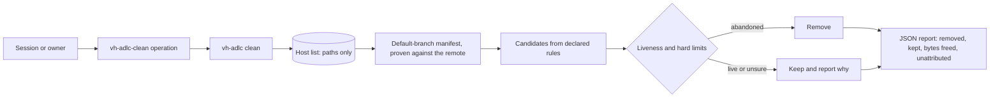

# Plan: Host cleanup

One shared, reviewed way for every project on a workstation to keep its temporary files in a known
place, declare what it owns, and let any agent session remove what killed runs left behind. The
`vh-adlc` binary gains `env` and `clean` commands, the plugin gains a `vh-adlc-clean` operation, and
the owner adds a few permission rules per harness so sessions stop getting blocked. Only rules on a
project's default branch can delete anything.

## Context

### What accumulates on this host

The owner reported on 2026-11-02 that the user's `/tmp` quota filled and blocked every session. The
measurements below were taken on host `fedora-43` the same day, before a reboot at 17:00
(`uptime -s`) emptied the tmpfs. After it, `df -h /tmp` showed 18M used and 27 entries. That resolves the
first incident for now, and the need stands, because every killed run starts the same accumulation.

- `df -h /tmp` shows a 16G tmpfs; `quota -s` shows user `m` at 9252M of a 12815M limit on it.
  `ls /tmp | wc -l` returned 4152 entries, and `find /tmp -maxdepth 1 ! -user 1000` found 15 that
  belong to other users.
- The largest entries (`du -s --block-size=1M /tmp/*`) are two
  `TestConformance_InProcessAndContainerReportTheSame*` directories of 454 MB each, which are
  `t.TempDir` leftovers of Stackweaver's
  `backend/internal/launcher/driver/conformance_integration_test.go:276` (branch
  `feat/runner-architecture` at `96eaff82`). Next come 22 `go-build*` directories (the three largest are
  145, 134 and 108 MB), seven `stackweaver-visuals-*` directories, the largest about 94 MB each,
  from `refresh()` in Stackweaver `scripts/docs-visuals/index.js:92` (`origin/main` at `50656333`), and other projects'
  entries such as `crossplane-docs-tools` (279 MB) and `stack-triage-rehearsal-OFjwII` (175 MB).
- vh-adlc leaks too: 74 `vh-triage-verification-<pid>` and 31 `vh-triage-locks-<pid>` entries come from
  `tests/vh-adlc/triage/fixtures.ts:4-5`, and `plugins/vh-adlc/scripts/ensure-vh-adlc.sh:109` creates
  `vh-adlc-ensure.*` under `${TMPDIR:-/tmp}`.
- Some user-owned entries are live and belong to no project: `claude-1000` (195 MB, Claude Code's
  session scratch), `containerd-mount4255318160`, `node-compile-cache` and `gopls-tempmod*`.
- Projects already pick their own temp roots under `~/.cache`: `gotmp` (393 MB), `sw-p6`, `sw-p8`,
  `sw-agent-a6bdb-gotmp` (167 MB) and 19 `sw-runner-arch-*` entries (`ls ~/.cache`, `du -sh`). A live
  Stackweaver test binary, pid 461166, ran for 43 minutes from
  `/home/m/.cache/sw-p8/tmp/go-build2963207335/b001/driver.test` (`ps -o pid,user,etime,cmd -p 461166`).
  `df -h ~/.cache` shows `/home` at 96% with 9.4G free.

Docker is one rootful engine shared by every project: `docker context ls` shows
`unix:///var/run/docker.sock`, and `docker info` reports server 29.7.2 with no rootless option.
`docker system df` reported 300 images (84.66GB, 61.81GB reclaimable), 86 containers, 68 volumes
(25.62GB, 16.7GB reclaimable) and 27.73GB of build cache. 45 of the 68 volumes are anonymous: their names
are 64 hex characters and their only label is `com.docker.volume.anonymous`.

- A live run's resources carry an ownership mark. `sw-test-db-87d6380a` and its siblings carry
  `sh.stackweaver.test-run=fedora-43/461166`, the pid above, which was still running.
- Networks `sw-test-jobs-5f77d912` and `sw-test-jobs-b4d91316` carry `sh.stackweaver.managed=true` but no
  `test-run` mark, so nothing records which run made them. `EnsureNetwork` gives every jobs network
  only `LabelManaged` (`backend/internal/launcher/driver/network.go:140` at `96eaff82`), and test jobs
  networks come through it, so a live run's jobs network has no mark today either.
- Compose slot stacks record their checkout. The `swc-6-*` containers carry
  `com.docker.compose.project.working_dir=/home/m/code/stackweaver/.claude/worktrees/agent-a6bdb414ef2821af6/deploy`
  (`docker inspect swc-6-api`), and that worktree still exists.
- Stackweaver's main dev stack is Compose project `deploy` (network `deploy_stackweaver`). Stackweaver
  treats its database as production with no backup (Stackweaver `CLAUDE.md:144`).
- Other tools leave containers no project label identifies: 30 containers with random names and only
  `io.crossplane.xpkg:*` labels, 29 of them exited (`docker ps -a`).
- `~/go/bin/kind get clusters` returned "No kind clusters found". Stackweaver's harness names its
  cluster `sw-e2e` (`e2e/k8s/run.sh:14`) and deletes it from an `EXIT` trap unless `KEEP_CLUSTER=1`
  (`e2e/k8s/run.sh:46,55`); a SIGKILL skips the trap. The 19 orphan networks the owner reported from
  another tool were no longer in `docker network ls`.

Stackweaver's launcher programs host firewall objects per jobs network: on iptables a chain pair
`SW-JOBS-<8 hex>` and `SW-JOBS-<8 hex>-IN`, and on nftables a table `sw_jobs_<8 hex>`, where the hex is
the start of the SHA-256 of the network name (`backend/internal/launcher/driver/network.go:196,342`,
`chainName`, `nftTableName`). It writes them from a one-shot container on the host network with
`NET_ADMIN`, running as uid 0 (`runFirewall`, `network.go:469,478`). Removing a network does not remove
them. Listing or removing them needs the same privilege, so this draft did not measure how many
remained before the reboot.

### Prior art in Stackweaver

`sweepEndedRuns` (`backend/internal/launcher/driver/leftovers_integration_test.go:82`, `96eaff82`)
already does this job for one package. Every resource that package's integration tests create carries
`sh.stackweaver.test-run=<host>/<pid>` (`:28`). `runEnded` (`:65`) calls a mark ended only when the host
matches and `kill(pid, 0)` returns `ESRCH`. The sweep removes containers, then the firewall chains of
their jobs networks (`:145`, using the ended run's own `sw-tools-*` image), then networks, volumes and
images. It never forces a removal, because Podman's forced removal also removes the containers using the
object (`:79-81`). `used` (`:192`) treats a failed listing as in use. The sweep runs only in that
package's `TestMain`, so it misses leftovers of other packages, scripts and harnesses.

Stackweaver's `scripts/agent-slot.sh` keeps slot locks in `/tmp/stackweaver-slots` (`:33`), and its `gc`
(`:394`) reclaims slot databases whose worktree is gone.

### Why sessions cannot clean up today

The owner reported that the auto-mode classifier refuses to sweep shared `/tmp`, remove anonymous
volumes or run a broad `pkill`, because it cannot tell one project's files from another's, and that an
agent may not grant itself an allow rule. Claude Code's documentation confirms the route around this:
an action that matches an allow rule resolves before the classifier sees it, and on entering auto mode
only broad rules (blanket `Bash(*)`, wildcarded interpreters, package-manager run commands) are dropped,
while narrow rules stay. Codex resolves commands against `prefix_rule` entries in
`~/.codex/rules/*.rules`. With codex-cli 0.163.0,
`codex execpolicy check --pretty --rules <file> -- vh-adlc clean --dry-run` against
`prefix_rule(pattern=["vh-adlc", "clean"], decision="allow")` returned `"decision": "allow"`, and a
command outside that prefix matched no rule. Claude Code here is 2.1.309 (`claude --version`).

Sessions act as the owner on GitHub: `gh api user` returns `michielvha`, the Git author on both
repositories. `stackweaver` is private and `vh-adlc` is public (`gh repo view`, `gh api`).
`gh api repos/michielvha/stackweaver/branches/main/protection` returns HTTP 403, "Upgrade to GitHub Pro or
make this repository public to enable this feature", and Stackweaver has no `.github/CODEOWNERS`.

### The vh-adlc binary and plugin today

- Every command is about feature documents: `knowledge`, `find`, `lint`, `gate`, `fresh`, `next` and
  `review check` (`cmd/vh-adlc/main.go:73`, `commands`). `dispatch` rejects any command without a
  40-character `--plugin-pin` (`main.go:158`).
- Output is one JSON object per run (`internal/report/report.go:97`, `Report.Write`). Finding codes
  are API and are added only in a minor release (`internal/report/codes.go:3`). The schema allows a
  null `knowledge` (`schema/vh-adlc.schema.json:37`) and exempts only `--version` from the JSON
  contract (`:5`).
- The plugin obtains the binary from `ensure-vh-adlc.sh`. The script accepts a `vh-adlc` on `PATH`
  whose digest matches the lock (`:83-94`), otherwise the cache entry
  `<cache>/vh-adlc/bin/<version>/<platform>/vh-adlc` (`:80`). Operations call the absolute path the
  script prints (`plugins/vh-adlc/references/loop.md:14`). The lock still names 0.1.0
  (`plugins/vh-adlc/vh-adlc.lock.json`), while the latest tag is `v0.8.0` (`git tag --sort=-v:refname`).
- Repository settings live in `.vh-adlc/`, with `schema_version: 1`, where unknown keys fail
  (`plugins/vh-adlc/references/triage-settings.md:7,35`) and settings carry no executable command
  strings (`plugins/vh-adlc/references/maintenance-settings.md:26`). Those files are JSON today;
  [yaml-settings.md](yaml-settings.md) moves them to YAML.
- `internal/fresh/fresh.go:97` finds the default branch from the local `refs/remotes/origin/HEAD`.
  `internal/testrepo/testrepo.go:46` already strips `GIT_` variables for test isolation.
- The binary resolves its cache with `os.UserCacheDir` (`internal/knowledge/knowledge.go:92`) and
  already depends on `go.yaml.in/yaml/v3` (`go.mod:5`).

In Go 1.27, `GOTMPDIR` sets the directory for both the go command's and the testing package's temporary
files (`go help environment`, `go doc testing.T.TempDir`), and `os.TempDir` returns `$TMPDIR`
(`go doc os.TempDir`). `os.Root` keeps every access beneath its directory, including through symlinks,
but does not stop traversal into bind mounts (`go doc os.Root`). A Unix socket path is limited to 108
bytes on Linux (`man 7 unix`). Git runs `core.sshCommand`, which a repository's own `.git/config` can
set, in place of `ssh` for fetches (`man git-config`).

## Scope

In scope:

- A per-project temp root, a per-host `temp_base` setting, and `vh-adlc env`, which prints the
  environment that puts a project's `TMPDIR`, `GOTMPDIR` and Go test temp directories there.
- A committed `.vh-adlc/cleanup.yaml` per project, read from the repository's default branch.
- `vh-adlc clean`: dry run, one project or every project on the host list, built-in hard limits, opt-in
  heavy kinds, and a report of what it removed, what it kept and the space it freed.
- Proof that the rules came from the default branch the remote names, and an automatic host list that
  holds paths only.
- The `vh-adlc-clean` operation, its references, its lifecycle routing row and package checks.
- Documented permission rules for Claude Code and Codex, and `vh-adlc` on `PATH` as the binary they name.
- Firewall object removal through a digest-pinned image, behind `--firewall`.
- vh-adlc's own manifest for its test leftovers, and the Stackweaver adoption described under
  [Stackweaver adoption](#stackweaver-adoption). Stackweaver's manifest, entry point, network mark and
  kind mark changes land in the Stackweaver repository, in its own reviewed change.
- A binary release and the plugin lock bump that makes the new commands available to the plugin.

Out of scope:

- Moving the existing triage, maintenance and audit settings to YAML, and the conventions rule against
  choosing JSON over YAML. That is a separate outcome with its own consumers and release order, so it
  has its own document, [yaml-settings.md](yaml-settings.md). This feature shares only its strict
  Go parser, `internal/settings`, and whichever feature lands first adds that package.
- Running the binary as root or through `sudo`, and any other user's files. The firewall container is
  the one privileged step; it runs on the engine and only with `--firewall`.
- Signalling host processes, as a broad `pkill` would. Only engine containers that a rule calls abandoned are stopped.
- Engine-wide pruning (`docker system prune`, `docker volume prune`, the build cache, unlabelled dangling
  images), because pruning ignores ownership. The report counts these leftovers but never removes them.
- Anonymous volumes and unlabelled containers that no declared rule attributes, such as the 45 volumes
  above. They are reported as unattributed; removing them stays a manual owner decision.
- Directories outside `/tmp` and the temp root, including `~/.cache/go-build` (22G) and the ad hoc
  `~/.cache/sw-*` roots. Go's own cache has `go clean -cache`; the old roots are removed once by the
  owner after Stackweaver adopts `vh-adlc env`.
- Cloud resources that cloud-proof harnesses create. Only their local files are in scope.
- Where agent harnesses put their own scratch files, such as `claude-1000`.
- Replacing each project's own cleanup code. Projects still clean up after themselves; this catches what
  killed runs and ended sessions leave.
- A timer, a registration command and manifest commands. Scheduled cleanup would be a later feature.
- Hosts other than Linux. The binary refuses them; macOS would need its own in-use checks and deny rule.

## Design

### Owner decisions

The owner answered every question on 2026-11-02. This design folds in those answers:

| Topic | Decision |
| --- | --- |
| Manifest | `.vh-adlc/cleanup.yaml`. YAML is the standard for settings; the wider migration is [yaml-settings.md](yaml-settings.md). |
| Temp root | A per-host setting, defaulting to `/tmp/vh-adlc-<uid>/<project>`. |
| Schedule | On demand only in v1. |
| Trust | No registration. Rules come from the repository's default branch, so a branch or uncommitted edit only gets a dry run. `trusted_remotes` is confirmed, with `github.com/michielvha/` and `github.com/vhco-pro/` on this host. |
| Harnesses | Claude Code and Codex, both in v1. |
| Commands | None in the manifest. |
| Firewall | A firewall rule behind `--firewall`, through a digest-pinned image. |
| Binary | `vh-adlc` on `PATH`, rule `Bash(vh-adlc clean *)`. |

The owner has not settled what a default-branch commit proves about review, or which repository owns
shared globs. Those are Q1 and Q2 under Open Questions.



<details>
<summary>Legend</summary>

The host list says which repositories to visit and holds no rules. Each repository's rules are read
from the commit its remote names as the default branch head. A candidate is anything a rule matches.
Liveness and the hard limits decide removal, and any rule that reads live keeps the object.

</details>

### Commands

`vh-adlc clean` and `env` do not resolve conventions, so `dispatch` exempts them from the
`--plugin-pin` requirement and their reports carry `knowledge: null`. The logic lives in a new
`internal/clean` package; `cmd/vh-adlc/main.go` only wires flags. v1 supports Linux only, because the
in-use checks, the socket paths and the deny rule are all Linux-shaped. On any other platform both
commands report `unsupported-platform` and do nothing.

- `vh-adlc env [--repo DIR] [--sh]` creates the project's temp root if needed and reports `TMPDIR` and
  `GOTMPDIR` for it. `--sh` prints `export` lines for `eval` instead of JSON; the schema description
  lists it beside `--version` as the second exception to the JSON contract. On failure `--sh` prints
  nothing to stdout, writes the JSON report to stderr and exits non-zero. `env` deletes nothing, so
  it reads the manifest from the working tree.
- `vh-adlc clean [--firewall] [--kind] [--repo DIR | --all-projects] [--dry-run] [--older-than DURATION]`
  plans and applies removal. `--repo` defaults to the current directory. `--older-than` can only raise
  a rule's age, never lower it, so an allowed session cannot widen what is removed. `--firewall` and
  `--kind` enable the heavy kinds, and the binary accepts them only directly after `clean`, so a
  permission rule can see them.

No flag names a manifest, a remote or a host list, so the allow rule cannot be pointed at other rules.
Tests reach those seams through `internal/clean` options, never through the command line.

New finding codes, added in the same minor release, and how they set the result. A dry run reports
`answered` unless a code below says `error`. An applied run reports `pass` when nothing below sets `fail`.

| Code | Applied result |
| --- | --- |
| `running-as-root`, `unsupported-platform`, `busy`, `host-settings-invalid` | `error`, exit 4; nothing ran |
| `removal-failed`, `manifest-invalid`, `manifest-overlap`, `remote-unverified`, `temp-base-refused`, `engine-unreachable`, `kind-unavailable` | `fail`, exit 1; other projects still ran |
| `remote-untrusted`, `manifest-missing` | `fail` with `--repo`; only counted with `--all-projects`, where such a repository was never in question |
| `manifest-unmerged`, `temp-root-undeclared` | Reported; no effect on the result |

`env` uses the same codes. It fails on `temp-root-undeclared`, so a project that calls `env` without
declaring `temp_root` finds out.

### Host settings and the host list

Two per-user files hold host state. Neither lives in a repository, and neither holds cleanup rules.

`<user config dir>/vh-adlc/host.yaml` is the owner's optional setting, `schema_version: 1`. It has
`temp_base`, the base of every temp root, and `trusted_remotes`, a list of normalized prefixes. This
host's list is `github.com/michielvha/` and `github.com/vhco-pro/`. With no list, applied runs remove
nothing. An invalid file reports `host-settings-invalid`.

`<user cache dir>/vh-adlc/projects.yaml` is the host list. `vh-adlc knowledge`, `env` and `clean` add the
repository's canonical path on first use, from `git rev-parse --git-common-dir`, so every worktree
counts as one repository. Operations that resolve conventions start with `knowledge`
(`plugins/vh-adlc/references/loop.md`), and the cleanup operation calls `clean` directly, so a project
gets on the list by using vh-adlc. The file holds paths and nothing else, and adding a path grants
nothing, because rules still come through the proof below. A write that fails, for example on a full
disk, is reported and does not stop the run.

`vh-adlc clean --all-projects` visits every listed repository. A path that no longer holds a Git
repository is dropped and reported. A repository with no manifest on its default branch has nothing
to clean and is counted. One project's failure does not stop the others.

### Where the rules come from

Only rules on the default branch delete anything. Every `clean` run, dry or applied, proves that for
each listed repository in these steps:

1. Read `remote.origin.url`. It must parse as exactly `<host>/<owner>/<repo>` in an `https://` or SSH
   form, after dropping any user name and a trailing `.git`, as Stackweaver's
   `https://michielvha@github.com/michielvha/stackweaver.git` needs. Dot segments, percent escapes,
   queries, fragments, extra path segments, local paths, `file://`, `http://` and `ext::` report
   `remote-unverified`. Those checks are on the text, because Git collapses
   `https://github.com/michielvha/../octocat/Hello-World.git` before any request, so
   `http.followRedirects=false` alone does not stop it. A URL under no `trusted_remotes` prefix reports
   `remote-untrusted`.
2. From a neutral working directory, with every `GIT_*` variable removed from the environment,
   `GIT_TERMINAL_PROMPT=0` set and `http.followRedirects=false`, run
   `git ls-remote --symref -- <url> HEAD`. That gives the default branch and its head commit as the
   remote states them. A redirect to another repository fails the proof. The owner's global Git
   configuration still applies, so credentials work.
3. In a new empty bare repository, fetch that branch with `--depth=1`, `--no-tags` and
   `--filter=blob:none`, require the fetched commit to equal the head from step 2 (retrying once if the
   branch moved), and read the manifest with `git cat-file blob <commit>:.vh-adlc/cleanup.yaml`.

Each remote step has a 30-second timeout. Proof directories live under `$XDG_RUNTIME_DIR/vh-adlc/`, a
private tmpfs apart from `/tmp` (3.2G free on this host, `df -h /run/user/1000`), falling back to the
user cache directory, never `/tmp`. Git's own `TMPDIR` points there too. Each directory is removed as
soon as its project is read, with a budget of 1 MiB, and Stackweaver measured 280K. The binary writes
nothing to `/tmp` and keeps its lock in the same place, so `clean` works with the `/tmp` quota full.

The local `origin/<default>` ref is not evidence: any local process can move it, and it is what
`internal/fresh/fresh.go:97` resolves today. Git commands that talk to the remote also never run inside
the project's repository, because `core.sshCommand` in a repository's `.git/config` would make Git run
that command under the allow rule. Inside a project repository the binary runs only
`git rev-parse --git-common-dir`, `git config --local --get remote.origin.url`,
`git symbolic-ref refs/remotes/origin/HEAD` and `git cat-file blob`, each with `GIT_NO_LAZY_FETCH=1`,
because a read of a missing object in a partial clone can otherwise fetch and run that same command.
Proofs run four at a time for every listed trusted repository, because the overlap check below needs them.

A failed step removes nothing for that project and the run reports why. A dry run with no proof falls
back to the local default-branch ref for its plan, reports `remote-unverified`, and marks the plan's
`rules_source` as `local`. Otherwise `rules_source` is `proven`, so a dry run works offline and says so.

When the working tree's manifest differs from the proven one, or a branch introduces the file, an
applied run still uses the proven rules and reports `manifest-unmerged`. A dry run also plans the
working-tree copy with `rules_source: worktree`, so a change can be tried before it merges.

### Temp root

Each project gets `<temp_base>/<project>`, mode 0700 and owned by the user. `temp_base` defaults to
`/tmp/vh-adlc-<uid>`, which is tmpfs on this host, keeps paths short for Unix sockets and clears at
reboot. `<project>` comes from the manifest and matches `^[a-z0-9][a-z0-9-]{1,38}$`. A project opts in
with one manifest setting (`temp_root`), and its build and test entry points take their environment
from `vh-adlc env --sh`. A base missing after a reboot is normal: `env` recreates it, and `clean` has
nothing to do there.

`/tmp` is shared, so `env` and `clean` report `temp-base-refused` for a base that is a symlink, is owned
by someone else, or is not mode 0700. `env` writes a marker file when it creates a base, and `clean`
acts only under a base holding that marker. Both also refuse a base that is the home directory, or that
is inside or an ancestor of a listed repository, so a changed `temp_base` cannot aim `clean` at a
checkout.

Inside the root, an entry is abandoned when nothing in its tree changed for longer than the configured
age and the in-use check below clears it. The walk uses `lstat`, never follows symlinks, and stops at a
device boundary.

### In-use check

A file entry in `/tmp` or a temp root is in use, and is kept, when any of these holds:

- A process of the same uid has its `cwd`, `root`, `exe`, an open file descriptor or a mapping in
  `/proc/<pid>/maps` inside the entry. A pid that exits during the scan is skipped. Any other read error
  on a same-uid pid counts as in use.
- `/proc/net/unix` lists a bound socket path inside the entry, whichever user bound it.
- A container on the Docker or Podman socket, running or not, has a bind mount whose `Mounts` source is
  inside the entry. This is how a root process in a container is seen. A missing socket or a refused
  connection means no engine is running there. Any other engine error keeps every file entry in that
  run and reports `engine-unreachable`.

Processes of other uids are not inspected, because `/proc/<pid>/cwd` and `fd` are unreadable to the user:
as uid 1000, 429 of 532 pids here had an unreadable `cwd`. So a root process outside any container that
holds a user's `/tmp` entry is not seen. The age is the only protection in that case, and the
reference says so.

### Ownership manifest

`.vh-adlc/cleanup.yaml` is data with `schema_version: 1`, parsed by the strict `internal/settings` package
that [yaml-settings.md](yaml-settings.md) defines, which uses `yaml.v3`. It holds one document, unknown
keys and duplicate keys fail, and aliases are refused. No field holds a command. In full:

```yaml
schema_version: 1
project: stackweaver
temp_root: {max_age: 24h}
tmp:
  - {glob: "TestConformance_*", max_age: 12h}
label_namespace: sh.stackweaver.
docker:
  engines: [docker, podman]
  rules:
    - kinds: [container, network, volume, image]
      match: {sh.stackweaver.managed: "true"}
      liveness: {kind: pid, label: sh.stackweaver.test-run}
      anonymous_volumes: true
    - kinds: [container]
      match: {sh.stackweaver.role: slot-tool}
      liveness: {kind: path, label: sh.stackweaver.worktree}
compose:
  - {project: "swc-*", volumes: true}
kind:
  - {cluster: sw-e2e, mark_label: sh.stackweaver.kind-run}
firewall:
  image: ghcr.io/example/tools@sha256:<64 hex>
  iptables_chain_prefix: SW-JOBS-
  nft_table_prefix: sw_jobs_
```

`match` is exact key and value pairs. The second Docker rule shows the `path` form; Stackweaver's own
manifest needs only the first. An object without the rule's liveness label is not matched, so it stays. When several rules match an object, any rule that
reads live keeps it. Liveness is a fixed vocabulary in the binary:

- `pid`: the label holds `<host>/<pid>`. The resource is abandoned only when the host is this host and
  `kill(pid, 0)` returns `ESRCH`. Another host, an unparseable value, a live pid of any user and a reused
  pid all count as live. This is Stackweaver's `runEnded`.
- `path`: the label holds an absolute path; the resource is abandoned when `lstat` returns `ENOENT`.
  Compose rules always use `com.docker.compose.project.working_dir`.

Engine objects have no age rule. An age cannot tell an idle live object from an abandoned one, and
Stackweaver's jobs networks sit idle between jobs. A project that needs another kind asks for one in
vh-adlc, where it is reviewed and tested.

A kind cluster has no owner mark of its own, so its harness creates one: a Docker volume labelled
`<mark_label>=<host>/<pid>` and `io.x-k8s.kind.cluster=<name>`, read with the `pid` rule. A cluster with no
mark is never touched, which is how a harness keeps one for debugging: it removes its mark.

Shared tool patterns such as `go-build*` and `gopls-tempmod*` belong to no single project. Q2 settles
which repository declares them, and the overlap check stops any other project from claiming them.

The binary refuses a manifest, reporting `manifest-invalid`, when:

- any `tmp`, `compose.project` or `kind.cluster` glob has fewer than four literal characters
  before its first metacharacter;
- `label_namespace` has fewer than eight characters, does not end in `.`, or starts with a namespace a
  tool owns: `com.docker.`, `io.x-k8s.`, `io.containers.`, `org.opencontainers.`;
- a Docker rule has no liveness, or a `match`, liveness or `mark_label` key lies outside the namespace;
- a glob matches a reserved entry such as `claude-<uid>`, `systemd-private-*`, `.X11-unix`,
  `tmux-<uid>` or the temp base itself;
- a `firewall.image` is not `<name>@sha256:<64 hex>`, or a firewall prefix has fewer than four characters;
- an age is below one hour.

Overlap is checked on every run across the manifests the run could read. When a glob's literal prefix
is a prefix of another project's, or two projects share a name, a label namespace, a firewall prefix or
a Compose or kind pattern, both projects report `manifest-overlap` and remove nothing, and every other
project proceeds. A listed repository that cannot be proven this run takes part through its local
default-branch copy, which can only hold others back. The check sees listed repositories only, so a lost
or new host list narrows it, and the report's `overlap_checked_against` count shows that. Overlap catches
mistakes between trusted projects. The trust boundary is `trusted_remotes` and the default branch.

### Removal and hard limits

These hold regardless of what a manifest declares:

1. A run as effective uid 0 removes nothing and reports `running-as-root`.
2. Files are removed only when they are top-level `/tmp` entries owned by the user and matched by a
   declared glob, or entries inside the project's temp root. A symlink is skipped and never followed.
   An entry that contains a mount point in `/proc/self/mountinfo` is skipped, because `os.Root` would
   descend into a bind mount. Removal goes through `os.Root.RemoveAll` on the entry.
3. Engine objects are matched only by declared rules. Removal is never forced. Containers go first,
   with `v=1` when the rule sets `anonymous_volumes`, so their anonymous volumes go with them. Then
   firewall objects (with `--firewall`), networks, volumes and images, in Stackweaver's order. An object
   still in use, or one whose usage listing fails, is kept.
4. A running container is stopped, with a ten-second timeout, only when its rule's liveness says it is
   abandoned. A process outside an engine is never signalled.
5. Only Unix sockets are used: `DOCKER_HOST` when it is `unix://`, otherwise `/var/run/docker.sock`,
   and `$XDG_RUNTIME_DIR/podman/podman.sock` for Podman. A declared engine that is not running reports
   `engine-unreachable`, and file work follows the in-use check.
6. One run at a time per user: an exclusive lock on `$XDG_RUNTIME_DIR/vh-adlc/clean.lock`, falling back
   to the user cache directory. A second run reports `busy`.
7. `kind` clusters are deleted only with `--kind`, only when their mark's `pid` rule says abandoned. The
   binary first stops the node containers under rule 4, and then runs `kind delete cluster --name <name>`
   with a fixed argument list, because kind removes nodes with `docker rm -f -v`. Stopping first means
   that force kills nothing, and it holds only for nodes already called abandoned. The mark goes last.
   `kind` must be on `PATH`, otherwise the run reports `kind-unavailable`. The shared `kind` network is
   never removed.
8. Without `--firewall`, a network with a firewall rule is kept with reason `firewall-chain-pending`, so
   a cleanup never creates the orphan chains it is meant to remove.

Bytes freed are counted from `st_blocks` during the walk for files and from the engine's reported sizes
for images and volumes. The report marks image sizes as an upper bound, because layers can be shared.

### Firewall

The binary stays unprivileged. With `--firewall`, it asks a rootful engine to run one short-lived
container from the manifest's digest-pinned image: host network, `NET_ADMIN`, uid 0, as in Stackweaver's
`runFirewall`. The manifest supplies only the image and the name prefixes, and the script is fixed in
the binary, so a manifest cannot add a command. Names reach the script only after matching
`^[A-Za-z0-9_-]{1,32}$`. The image is pulled by digest and must provide `iptables`; `nft` is used when
present. A rootless engine has no host firewall access, so the rule is skipped there.

The order prevents a false orphan. The script first lists iptables and ip6tables chains and nftables
tables in the `inet` and `bridge` families that carry the declared prefixes. Only then does the binary
list networks on every engine in the manifest, because a network always exists before its firewall
objects. An object's owner is found by name: the prefix followed by the first eight hex characters of
the SHA-256 of a network name, compared without case, because `chainName` is uppercase and `nftTableName`
lowercase, with a `-IN` sibling chain. Other naming schemes need a change in vh-adlc. An object that
hashes to no network is an orphan, which covers chains whose networks are already gone. Any failed
listing, including a declared engine that is not running, orphans nothing.

For an orphan or a network being removed, the script deletes the jumps from `DOCKER-USER` and `INPUT`,
flushes and deletes the chains, and deletes the nftables tables, in that order and before the network
goes. Stackweaver's test-only forward allowances, keyed by subnet (`dockerForwardAllowanceRemoval`), stay
with its own sweep.

### Report

`data` holds the binary's `version`, then one entry per project with its `rules_source`, the commit its
rules came from, `overlap_checked_against`, its candidates (kind, name or ID, rule, reason such as
`pid ended fedora-43/461166` or `working dir missing`, action and bytes), its totals and its findings.
Actions are `would-remove`, `removed`, `kept-live`, `kept-in-use`, `kept-young`, `skipped-symlink`,
`skipped-mount`, `firewall-chain-pending` and `failed`. A host section lists unattributed leftovers by
count and size: user-owned `/tmp` entries that no manifest matches, anonymous volumes, stopped containers
with no rule, dangling images and the build cache.

### The operation

`plugins/vh-adlc/skills/vh-adlc-clean/SKILL.md` runs `vh-adlc clean --dry-run` for the current project,
or with `--all-projects` on request, and summarises the plan. It applies the plan when the user asked
for cleanup or the session is blocked on space. It stops only for projects with no proven rules, reports
the finding and what clears it, and carries on with the rest. `manifest-unmerged` alone does not stop it.
It passes `--firewall` or `--kind` only when the user named them. It never removes these resources with
`rm`, `docker rm` or `pkill`.

`references/clean.md` holds the procedure and `references/clean-settings.md` the manifest and host
fields, following the triage and maintenance settings references. `references/lifecycle.md` gains a
"Host cleanup" row. The reference also says what to do when `/tmp` is so full that a session's own shell
cannot run: the owner runs `vh-adlc clean --all-projects` in a terminal.

`clean` needs no conventions, so this operation skips `knowledge`. `references/loop.md` names that
exception, and `tests/vh-adlc/check.test.ts` gains a host-operation category beside
`CONTENT_OPERATIONS` that does not require the `vh-adlc knowledge` line.

It calls `vh-adlc` from `PATH`, the form the allow rule matches. The Bash tool's `PATH` on this host is
`/usr/local/bin:/usr/bin`, so `~/.local/bin` and `~/go/bin` are absent, and `/usr/local/bin` is the one
location on it. It is also root-owned, so no session can replace the binary. The owner installs once per
lock bump:
`sudo install -m 755 "$(bash <plugin directory>/scripts/ensure-vh-adlc.sh)" /usr/local/bin/vh-adlc`, and
`kind` the same way if `--kind` is wanted. The operation does not run `ensure-vh-adlc.sh`, which needs a
rule of its own and executes a mismatched candidate to read its version. It compares the report's
`version` with the plugin lock instead, and prints the install line when they differ or `vh-adlc` is missing.

### Permission rules

The owner adds the rules once, in user scope, so they apply in every project:

- Claude Code, `~/.claude/settings.json`: `"allow": ["Bash(vh-adlc clean *)", "Bash(vh-adlc env *)"]`,
  `"ask": ["Bash(vh-adlc clean --firewall *)", "Bash(vh-adlc clean --kind *)"]`, and
  `"deny": ["Edit(~/.config/vh-adlc/**)"]`. An ask rule wins over an allow rule, so the heavy kinds are
  opt-in for a person as well as a session. The deny rule stays because `host.yaml` decides the temp base
  and which remotes are trusted. Claude Code splits compound commands before matching and does not match
  an allow rule past an unknown leading variable assignment, so `vh-adlc clean && rm -rf /tmp/x` and
  `PATH=/x vh-adlc clean` still go to the classifier.
- Codex, `~/.codex/rules/default.rules`:
  `prefix_rule(pattern=["vh-adlc", "clean"], decision="allow")`, the same for `env`, and
  `prefix_rule(pattern=["vh-adlc", "clean", ["--firewall", "--kind"]], decision="prompt")`, where the most
  restrictive match wins. On codex-cli 0.163.0, `codex execpolicy check` returned `prompt` for
  `vh-adlc clean --firewall --all-projects` and `allow` for `vh-adlc clean --dry-run`. The reference
  documents that check.

The classifier keeps refusing raw sweeps such as `rm -rf /tmp/*` and `docker volume prune`.

### Stackweaver adoption

Stackweaver adopts first, in its own repository. It:

- merges `.vh-adlc/cleanup.yaml` to its default branch;
- takes its test and build environment from `vh-adlc env --sh` in its entry points, guarded by
  `command -v vh-adlc`. Without the binary, as in CI or on a contributor's or self-hoster's machine, the
  entry point runs unchanged and prints one notice to stderr;
- adds `sh.stackweaver.test-run` to test jobs networks in `EnsureNetwork`, because
  `backend/internal/launcher/driver/network.go:140` gives them only `LabelManaged` at `96eaff82`;
- creates and removes the kind mark in `e2e/k8s/run.sh`, removing it when `KEEP_CLUSTER=1`.

vh-adlc merges its own manifest for `vh-triage-locks-*`, `vh-triage-verification-*`, `vh-adlc-ensure.*` and
each real test prefix, such as `vh-maintenance-*` and `vh-lifecycle-*`, which also exercises the overlap
check with two projects. None may match the temp base `vh-adlc-<uid>`.

The table is the acceptance fixture: the classes of leftover this host held on 2026-11-02 and the
outcome the design requires. The reboot cleared the `/tmp` rows and the firewall chains, and Stackweaver's
`sw-test-*` objects are gone too, so the real-host procedure recreates those rows as stand-ins with the
same names, marks and ages.

| Leftover | Rule | Required outcome |
| --- | --- | --- |
| `/tmp/TestConformance_InProcessAndContainerReportTheSame*`, 2 x 454 MB | `tmp` glob `TestConformance_*` | Removed once older than its age and not in use |
| `/tmp/stackweaver-visuals-*`, up to 94 MB each | `tmp` glob `stackweaver-visuals-*` | Removed once older than its age and not in use |
| `/tmp/go-build*`, 22 entries | The shared manifest Q2 names | Removed once older than its age and not in use |
| `/tmp/stackweaver-wt-api-*`, `/tmp/sw-kind*`, Stackweaver's Podman gate logs | `tmp` globs in Stackweaver's manifest | Removed once older than their age and not in use |
| Containers, networks and volumes with a live `test-run` mark | `pid` on `sh.stackweaver.test-run` | Kept while the pid lives, removed after it ends |
| A marked `sw-test-jobs-*` network whose run ended | `pid` on `sh.stackweaver.test-run` | Kept as `firewall-chain-pending` without `--firewall`; with it, firewall objects then the network removed |
| Networks `sw-test-jobs-*` with no `test-run` mark | None | Untouched, counted as unattributed |
| `stackweaver-jobs-slot-3*` networks | No `test-run` mark | Untouched |
| Compose `swc-N`, worktree present | `compose` `swc-*` | Kept as live |
| Compose `swc-N` whose worktree was removed | `compose` `swc-*` | Stopped and removed with its volumes |
| Compose `deploy`, the main dev stack | No rule matches | Untouched |
| `launcher-wt-3*` containers, labelled `deploy` without a working dir | No rule matches | Untouched, counted as unattributed |
| Anonymous volumes with no rule, 45 on the day | None | Untouched, counted as unattributed |
| kind cluster `sw-e2e` whose marked harness was killed | `kind` with `--kind` | Stopped and deleted |
| kind cluster `sw-e2e` with a live mark, or with no mark | `kind` | Untouched |
| `SW-JOBS-*` chains and `sw_jobs_*` tables of removed networks | `firewall` with `--firewall` | Removed; without the flag, untouched |
| `~/.cache/sw-p8` and the other ad hoc roots | Outside `/tmp` and the temp root | Untouched |

### Risks and safeguards

| Risk | Safeguard |
| --- | --- |
| Deleting a live run's files | Age and the in-use check, which covers same-uid processes, bound sockets and container mounts. A root process outside any container is not seen; age is the only protection there. |
| Deleting a live run's engine objects | `pid` and `path` liveness, any live rule winning, never forcing, and the in-use check before removing networks, volumes and images. `kill(pid, 0)` errors other than `ESRCH` count as live. |
| Deleting a live kind cluster | An unmarked cluster is never touched, and a marked one needs an ended pid. |
| Deleting another project's files | Only declared globs and labels, overlap refusal between listed projects, the four-character floor on every glob and the reserved names. |
| Deleting the Stackweaver dev database | The `deploy` project matches no rule, Compose liveness keys on the working directory, tool namespaces such as `com.docker.` are refused, and named volumes go only with a Compose rule that sets `volumes`. |
| An agent widening the rules on a branch | Branch and uncommitted manifests only dry-run. |
| An agent with push rights changing the default branch | Open as Q1. Any session holding the owner's token can push a wider manifest today, and the rule then applies with no classifier. The hard limits still hold for any manifest. |
| Moving the local `origin/<default>` ref | Runs read the commit the remote states; a local ref is only a labelled dry-run fallback. |
| Pointing `origin` somewhere else | Only an exact `<host>/<owner>/<repo>` under `trusted_remotes` is accepted. |
| A planted `core.sshCommand` or `url.*.insteadOf` in `.git/config` | Remote commands run outside the repository with `GIT_*` variables removed, and the short list of local reads runs with `GIT_NO_LAZY_FETCH=1`. |
| A third-party clone with a hostile manifest | `trusted_remotes` leaves it unproven, whatever its default branch says. |
| Editing `host.yaml` to redirect `temp_base` or trust a remote | The `Edit` deny rule and the base checks. A Bash write to the file still depends on the classifier, and Codex has no equivalent rule; the reference states both limits. |
| A session opting into the heavy kinds | The `ask` and `prompt` rules, and the first-position flag rule that lets them see the flags. |
| A manifest image with `NET_ADMIN` | Only a digest pin on the default branch, a fixed script, and a person's approval of `--firewall`. It is root-equivalent through the Docker socket, and the reference says so. |
| A fake `vh-adlc` on `PATH` | `/usr/local/bin` is root-owned and first on the Bash tool's `PATH`, and an allow rule does not match past a `PATH=` assignment. |
| Docker has no per-user ownership on a rootful engine | Ownership is the project's label plus liveness; the reference says the user check covers files only. |
| Following a symlink or bind mount out of `/tmp` | `lstat` walk, `os.Root`, the `mountinfo` check and the device boundary. |
| A false firewall orphan stripping a live network's isolation | Firewall objects are listed before networks, across every declared engine, and any failed listing orphans nothing. |
| Creating orphan firewall chains | `firewall-chain-pending` keeps those networks until `--firewall` removes their firewall objects first. |
| Temp roots filling the `/tmp` quota | The default base still counts against the quota, so a project can fill it between runs. `clean` writes nothing to `/tmp`, so it still works then, and `temp_base` can move the roots. |
| A remote that hangs | `GIT_TERMINAL_PROMPT=0` and a 30-second timeout per step, so a stuck remote cannot hold the lock. |
| Long temp paths breaking Unix sockets | The default base is short, and `env` reports the remaining budget against the 108-byte limit. |
| A pid reused by another process | Reuse reads as live, so the resource waits for a later run. |

## Acceptance Criteria

- [ ] AC-01: For a project with a manifest that declares `temp_root`, `vh-adlc env --repo <dir>` reports `TMPDIR`
      and `GOTMPDIR` under the project's temp root, which exists with mode 0700 and the user as owner. A
      `go test` run with that environment leaves its `go-build*` and test temp directories only under that root.
- [ ] AC-02: `vh-adlc clean --dry-run` reports every declared, abandoned resource of the project with its rule,
      reason and size, and leaves the filesystem and the engine unchanged, apart from vh-adlc's own host list
      and short-lived proof directories.
- [ ] AC-03: `vh-adlc clean` removes those resources and keeps entries owned by another user, entries no
      declared glob matches, symlinks and their targets, entries containing a mount point, entries a same-uid
      process uses through its working directory, a descriptor or a mapping, entries with a bound Unix socket
      or a container bind mount, entries younger than their age, objects that any matching rule reads as live,
      and Compose projects whose working directory exists.
- [ ] AC-04: No object in use is forced: a network, volume or image that a container still uses, or whose usage
      cannot be listed, remains and is reported as kept, and no running container is killed except by the
      stop that follows an abandoned verdict.
- [ ] AC-05: A manifest that exists only on a branch or as an uncommitted edit changes nothing when applied: a dry
      run shows its plan with `rules_source: worktree` and `manifest-unmerged`, and an applied run removes only
      what the proven default-branch rules declare.
- [ ] AC-06: The binary refuses a manifest with unknown or duplicate keys, aliases, more than one document, ages
      under one hour, a short prefix on any glob, reserved names, a tool-owned or short label namespace, or
      Docker rules without liveness or outside the namespace. Two projects with overlapping names, patterns,
      namespaces or firewall prefixes both remove nothing while other projects proceed.
- [ ] AC-07: Run as effective uid 0, `vh-adlc clean` removes nothing and reports `running-as-root`, with result
      `error`.
- [ ] AC-08: kind clusters and firewall objects change only with `--kind` or `--firewall`, which the binary accepts
      only directly after `clean`. Without `--firewall`, a network with a firewall rule remains, reported as
      `firewall-chain-pending`. With it, firewall objects that hash to no network on any declared engine are
      removed in every family, those of a live network remain, a network created during the run keeps its
      objects, a failed listing orphans nothing, and an image not pinned by digest is refused. A cluster with
      no mark or a live mark remains, and a cluster with an ended mark is stopped and deleted.
- [ ] AC-09: The report lists each removed and kept item with its reason, its `rules_source` and commit, the
      bytes freed per project and in total, and the unattributed leftovers it left alone, by count and size.
- [ ] AC-10: `vh-adlc clean --all-projects` visits every repository on the host list, reports a failing project
      without skipping the others, exits with `fail` when any removal or proof failed, and treats a listed
      repository that is untrusted or has no origin or manifest as counted, not failed.
- [ ] AC-11: With the documented user-scope rules, and `vh-adlc` resolving from each harness's own `PATH`, a Claude
      Code session in auto mode and a Codex session run the `vh-adlc-clean` operation, dry run and apply,
      without a permission prompt or refusal. `--firewall` and `--kind` ask a person first, and a direct
      `rm -rf` of a `/tmp` entry in the same session still goes to the classifier or approval.
- [ ] AC-12: With Stackweaver's and vh-adlc's manifests merged, the shared manifest Q2 names merged, and this host's
      `trusted_remotes` set, a dry run classifies every row of the Stackweaver adoption fixture as the table
      requires, and the owner accepts that report before the first applied run.
- [ ] AC-13: After the first applied run on this host, the fixture's removable rows are gone and every row the
      table keeps is still present. For stand-ins of known size, the report's bytes freed equal the files'
      `st_blocks` total and the engine's reported sizes for disposable objects.
- [ ] AC-14: The CLI reference, the installation and workflows guides, the compatibility table and the operation's
      references document `env`, `clean`, `host.yaml`, the host list, the manifest fields, the install step and
      all the permission rules, and the package checker accepts the new operation in its own category.
- [ ] AC-15: An applied run acts only on the manifest at the commit the remote names as its default branch head. A
      moved local `origin/<default>` ref, an `origin` URL that is local, `file://`, outside `trusted_remotes` or
      not exactly `<host>/<owner>/<repo>`, a redirect to another repository, and an unreachable remote all remove
      nothing for that project. A dry run proves first and labels any fallback. A `core.sshCommand` planted in the
      repository's Git configuration never runs in a dry or applied run, including through a lazy fetch.
- [ ] AC-16: Using vh-adlc in a repository records its canonical path on the host list with no rule data; every
      worktree counts as that one repository; a path no longer holding a repository is dropped; adding a
      path by hand grants nothing the proof does not; and a failed list write does not stop the run.
- [ ] AC-17: `temp_base` in `host.yaml` moves every temp root, the default is `/tmp/vh-adlc-<uid>`, and `env` and
      `clean` refuse a base that is a symlink, foreign-owned, not mode 0700, missing the marker, the home
      directory, or inside or an ancestor of a listed repository. A base missing after a reboot is recreated
      by `env` and is not a failure for `clean`.
- [ ] AC-18: With the `/tmp` quota exhausted, an applied run frees space and writes nothing to `/tmp`.
- [ ] AC-19: The plugin lock names a release containing `env` and `clean` for all four platforms, and the operation
      reports a mismatch between the installed binary and the lock with the install line.
- [ ] AC-20: `--older-than` below a rule's age changes nothing that rule removes, a second concurrent run reports
      `busy`, and with no engine running the file work still completes.
- [ ] AC-21: Every finding code maps to its documented result and exit code, and a failing `env --sh` prints nothing
      to stdout.
- [ ] AC-22: On a platform other than Linux, `env` and `clean` do nothing and report `unsupported-platform`.
- [ ] AC-23: On a host with `vh-adlc`, a Stackweaver test run leaves its temp files under the project's temp root and
      its jobs networks and kind cluster carry their marks. Without the binary, its entry points run unchanged
      and print one notice to stderr.

## Test Plan

| Criterion | Proof |
| --- | --- |
| AC-01 | `internal/clean` test on a temporary home: `env` creates the root with mode 0700. A `cmd/vh-adlc` test runs `go test` on a fixture module with the printed environment and asserts no new `go-build*` or test directory appears in the fake `/tmp`. |
| AC-02, AC-03, AC-07 | Fake-filesystem table tests in `internal/clean`: a `t.TempDir` stands in for `/tmp`, with injected uid lookup, clock, process table (`cwd`, `fd` and `maps`), `/proc/net/unix`, `mountinfo` and euid. Cases cover each kept category, an unreadable foreign pid, a same-uid read error and a symlink pointing outside the root. The dry-run case compares a full tree snapshot before and after. |
| AC-02, AC-03, AC-04 | Fake-engine tests: an `httptest` server on a Unix socket implements the engine endpoints used, records every call, and fails the test on any `force` parameter. Cases cover ended and live `pid` marks, other hosts, a missing and a present working directory, two rules disagreeing, a bind mount into a `/tmp` entry, in-use objects, a failed usage listing and a dry run making no mutating call. |
| AC-03, AC-04, AC-08 | Integration test behind a build tag against the real Docker engine and Podman where present: labelled objects with an ended mark (made like Stackweaver's `endedRunMark`) and a live mark, asserting only the ended ones go. `--firewall` uses disposable networks, chains and tables on a rootful engine only, including an orphan, a live network's objects and a network created between the two listings. `--kind` uses a disposable cluster with no mark, a live mark and an ended mark. |
| AC-05, AC-06 | Manifest table tests on local fixture repositories, through the `internal/clean` seam: each refusal, branch and uncommitted edits, two projects overlapping, a third project still proceeding, and an emptied host list showing `overlap_checked_against: 0`. |
| AC-08 | Fake-engine tests assert the firewall container's image reference, capabilities and exact script, the refused image forms, case-insensitive matching, both nftables families and ip6tables. A `cmd/vh-adlc` test asserts each heavy flag is refused outside the first position. |
| AC-09, AC-10 | Golden JSON reports for a two-project fixture with one failing removal and one untrusted repository, validated against the updated schema in `cmd/vh-adlc/schema_test.go`. |
| AC-11 | Written manual procedure, recorded under `tests/vh-adlc/evidence/clean/`: in disposable Claude Code (auto mode) and Codex sessions with only the documented rules, confirm `command -v vh-adlc`, invoke the operation, try each heavy flag, then request a direct `rm -rf` of a fixture entry, and record the prompts and refusals. `codex execpolicy check` output is recorded beside it. |
| AC-12, AC-13 | Real-host procedure: create the fixture's stand-ins, with some of known size in an isolated temp base, save the dry-run report, have the owner review it against the table, apply, and record the report and each row's after state under `tests/vh-adlc/evidence/clean/`. |
| AC-14 | `bun test tests/vh-adlc` with checks for the new skill, references, lifecycle row and host-operation category, plus a review of the documentation pages against the implemented flags. |
| AC-15 | Tests with a local bare repository behind the `internal/clean` remote seam: move the local ref, change the URL to each refused form, make the remote unreachable, and move the branch between the two steps. A canary uses an `ssh://` origin with a planted `core.sshCommand`: it must not appear from the binary, and a control fetch inside the repository must create it. A second canary uses a partial clone with a missing blob on the dry-run path. A test asserts the command line has no flag that reaches the seam. One real-host check against a private GitHub repository. |
| AC-16 | Table tests with a temporary cache directory: first use from a checkout and a worktree, a removed path, a hand-added path, a read-only list file and a file holding anything but paths. |
| AC-17 | Table tests on temporary directories for each refused base, including a pre-created foreign-owned base through the injected uid lookup, and a missing base. |
| AC-18 | A `cmd/vh-adlc` test under Bubblewrap with a filled, size-limited tmpfs at `/tmp` and a separate runtime directory: an applied run removes a stand-in, and a file-change listing shows no new `/tmp` entry. |
| AC-19 | `tests/vh-adlc/ensure.test.ts` and `bun test tests/vh-adlc` against the bumped lock, and a package check that the operation's mismatch text names the install line. |
| AC-20 | `internal/clean` tests: a lower `--older-than` plans the same removals, two runs contend for the lock, and a missing engine socket leaves file removal complete. |
| AC-21 | A table test walks every code in `report.Codes` that `internal/clean` emits and asserts its result and exit code; a `cmd/vh-adlc` test captures stdout of a failing `env --sh`. |
| AC-22 | A test with the platform injected through the `internal/clean` seam, and a check that the darwin builds compile. |
| AC-23 | In Stackweaver: run its driver tests through the entry point with `vh-adlc` installed and list the temp root, inspect the network and kind marks, then run the entry point with the binary absent from `PATH` and compare its behaviour. |

## Tasks

None yet; written once the document is planned.

## Open Questions

### Q1: What should a commit on the default branch have to prove before `vh-adlc clean` trusts it?

**Recommendation:** A. Accept that on the default branch means pushed by someone with write access, because every session already acts as `michielvha`, so paid protection would not separate an agent from you without a second GitHub identity.

| Option | You get | It costs |
| --- | --- | --- |
| **A. Accept "pushed", keep the hard limits** | No plan change and no owner step. Limits on globs, namespaces, ages, liveness and `--firewall` approval hold for any manifest | A session with your token can widen what `clean` deletes, inside those limits, with no classifier |
| **B. GitHub Pro, a required pull request and a code owner for `.vh-adlc/cleanup.yaml`** | Direct pushes to that path are blocked on private repositories | A paid plan, and a separate agent identity, because authors cannot approve their own pull requests and sessions act as you |
| **C. Make `stackweaver` public** | Free protection, with the same identity limit as B | A product decision about source visibility, far beyond cleanup |
| **D. A per-host acknowledgement of each changed manifest, outside the allow rule** | You see every rule change before it deletes anything, with no plan change | Brings back the owner step you removed by choosing no registration |

**Why this is yours:** the design promised "reviewed, merged rules", and on this account a merge proves neither review nor who did it. Whatever you pick becomes a Scope item and a criterion here. `vh-adlc` is public, so it can have branch protection for free under any option.

### Q2: Which repository owns shared globs such as `go-build*` and `gopls-tempmod*`?

**Recommendation:** A. `michielvha/vh-adlc`, because it already carries a manifest and needs no new repository, and it is public, so its default branch can be protected for free.

| Option | You get | It costs |
| --- | --- | --- |
| **A. `michielvha/vh-adlc`** | One manifest to review, listed on any host that uses vh-adlc, and AC-12 can pass with no new repository | A tool repository declares rules for files other projects leave; an adopter's own glob for those names overlaps it and stops both |
| **B. A new private repository for this workstation** | Host-specific rules stay with the host and out of the public tool | One more repository to create, list and keep; it has Q1's protection gap |
| **C. Nobody owns them** | Nothing new; temp roots stop new `go-build*` entries for adopted projects | Leftovers from other tools stay in `/tmp`, counted as unattributed, and the fixture row changes to untouched |

**Why this is yours:** `go-build*` is one of the largest recurring classes, and no project can claim it without you deciding who speaks for the whole host.

## Review Log

| Date | Review | Kind | Commit | Model | Isolation | Outcome |
| --- | --- | --- | --- | --- | --- | --- |
| 2026-11-02 | R-1 | spec | `5dbeab86b1c11bf1cd5affd42e0d5e50fd04d140` | claude-opus-5-5 | procedural | 26 findings, 7 blocking |

### R-1

FINDING: F-01
KIND: factual
SEVERITY: blocking
WHERE: Design, Where the rules come from and The operation
EVIDENCE: Lines 304-305: a dry run "needs no proof: it falls back to the local default-branch ref and reports `remote-unverified`". Line 439: the operation starts with `vh-adlc clean --dry-run`. Lines 441-442: "When a project's rules are unmerged, unproven or untrusted, it reports the finding and what clears it, and removes nothing." So every operation run sees `remote-unverified` and never applies, and AC-11 (dry run and apply) cannot pass. Line 301 also says "Every run does this" proof, which contradicts line 304. Lines 307-308 have the binary apply the proven rules with `manifest-unmerged`, while the operation refuses on that same finding, so a session on a branch that edits the manifest cannot clean.
PROPOSAL: Make the dry run attempt the proof first and report `remote-unverified` only when the proof fails, with a field saying which rules it used. State that the operation stops only for projects with no proven rules, and that `manifest-unmerged` alone does not stop an apply.

FINDING: F-02
KIND: judgement
SEVERITY: blocking
WHERE: Design, Where the rules come from; Acceptance Criteria
EVIDENCE: The incident is a full `/tmp` quota that "blocked every session" (line 40). Line 292 puts the proof's bare repository in "a per-run temporary directory" with no location given, and `go doc os.TempDir` gives `$TMPDIR`, else `/tmp`. Line 304: "A failed step removes nothing for that project." The default temp root and the Claude Code scratch directory are also on that tmpfs. `df -h ~/.cache` now shows `/home` at 98% with 4.5G free. No criterion or Test Plan row runs `clean` with `/tmp` at its quota. With every box ticked, the command can fail in exactly the state it exists to fix, and on demand is the only schedule (line 206).
PROPOSAL: Fix the proof's temporary location outside `/tmp` and hold its size budget, and add a criterion that an applied run frees space with the `/tmp` quota exhausted. State which route works when the session's own shell cannot write, such as the owner's terminal.

FINDING: F-03
KIND: factual
SEVERITY: blocking
WHERE: Design, Temp root; Risks and safeguards
EVIDENCE: Lines 232 and 504: "a failed check counts as live". Line 327 decides use by reading `cwd`, `root`, `exe` and `fd` in `/proc/<pid>`. As uid 1000 here, `readlink /proc/1/cwd` returned rc=1, `ls /proc/1/fd` gave Permission denied, and 429 of 532 pids had an unreadable `cwd`. Taken literally, no entry is ever removed on a normal Linux host. If foreign pids are skipped instead, a rootful container that bind-mounts a `/tmp` entry is invisible, because its processes are root and its mounts are in another namespace, so `/proc/self/mountinfo` does not show them. The listed links also miss listening Unix sockets (the fd link reads `socket:[n]`) and memory-mapped files.
PROPOSAL: Define what an unreadable `/proc` entry of another uid means and state the resulting limit. Add an engine check of container `Mounts` sources, and decide whether sockets and maps count, with a Test Plan case for each.

FINDING: F-04
KIND: factual
SEVERITY: blocking
WHERE: Design, Removal and hard limits rule 7; Scope
EVIDENCE: Rule 7 deletes a cluster with `kind delete cluster` when node containers "are older than the rule's age", with no liveness check. kind's docker provider `DeleteNodes` runs `docker rm -f -v` ("force the container to be delete now", `pkg/cluster/internal/providers/docker/provider.go:143-145`). That contradicts line 381 (limits hold regardless of the manifest), rule 3 ("Removal is never forced"), rule 4 and Scope line 181 ("Only engine containers that a rule calls abandoned are stopped"). The goal says "has abandoned", but a live `e2e/k8s/run.sh` run or a `KEEP_CLUSTER=1` cluster older than the age is deleted. The risk row on engine objects names only `pid` and `path` liveness, and no criterion keeps a live cluster.
PROPOSAL: Require real liveness for a cluster, for example a `pid` mark on a harness-owned object or a stopped-nodes condition, and add a criterion that a live cluster stays. Otherwise state rule 7 as a named exception to the never-forced limit, with the owner's agreement.

FINDING: F-05
KIND: factual
SEVERITY: blocking
WHERE: Acceptance Criteria, AC-12 and AC-13; Stackweaver adoption
EVIDENCE: AC-12 needs only "Stackweaver's and vh-adlc's manifests merged" yet requires every fixture row to classify. The row `/tmp/go-build*`, 22 entries, needs "Shared host manifest, not Stackweaver", and lines 361-363 put that in a repository the owner keeps, "for example dotfiles". Scope, Stackweaver adoption and the Test Plan name no such repository, and `ls ~/code | grep -i dot` returned nothing. It must also be on the host list and under `trusted_remotes`. As written, AC-12 and AC-13 cannot pass, and one of the largest recurring classes has no owner.
PROPOSAL: Name the shared repository, or assign the `go-build*` and `gopls-tempmod*` globs to one existing repository, and add it to Scope and to AC-12. Otherwise change the row to untouched and counted as unattributed.

FINDING: F-06
KIND: factual
SEVERITY: blocking
WHERE: Design, Risks and safeguards, row "An agent with push rights changing the default branch"
EVIDENCE: The row says Stackweaver's manifest "needs branch protection or a code owner for that one path". `gh api repos/michielvha/stackweaver/branches/main/protection` returned HTTP 403, "Upgrade to GitHub Pro or make this repository public to enable this feature", and rulesets returned the same. `gh repo view` reports the repository PRIVATE. Both it and vh-adlc report `"protected": false`. `git show main:.github/CODEOWNERS` returned nothing. No Scope item, criterion or Open Question covers this, so any session with push rights can merge a wider manifest and run it through the allow rule with no classifier, and "merged" proves nothing about review.
PROPOSAL: Raise it as an owner decision with options: a paid plan, a public repository, or an explicit acceptance that merged means pushed. Then add the outcome to Scope and a criterion, because Open Questions "None." does not hold while this is undecided.

FINDING: F-07
KIND: factual
SEVERITY: blocking
WHERE: Design, Where the rules come from; Risks row on `core.sshCommand`; AC-15
EVIDENCE: Lines 298-300 keep remote commands out of the repository, but the dry-run fallback at line 305 reads a local ref inside it, under the same allow rule. In a scratch repository with `extensions.partialClone=origin`, `remote.origin.promisor=true`, an `ssh://` origin, a planted `core.sshCommand` and a ref whose blob was missing, `git cat-file blob origin/main:.vh-adlc/cleanup.yaml` ran the planted command (canary file created). A local read can therefore become a lazy fetch. The risk row's "repository configuration is never read for them" and AC-15's "never runs" are both false for this path.
PROPOSAL: Set `GIT_NO_LAZY_FETCH=1` or pass `--no-lazy-fetch` on every Git command run inside a project repository, and list the only local commands the binary may run. Extend AC-15 to dry runs with this case.

FINDING: F-08
KIND: factual
SEVERITY: should-fix
WHERE: Test Plan, AC-15
EVIDENCE: The row tests "a local bare repository" and a planted `core.sshCommand` canary. In a scratch repository, `git fetch origin` with a local-path origin and a planted `core.sshCommand` created no canary, while the same fetch with an `ssh://` origin created it. Git never calls ssh for a local remote, so the proof passes even if the binary runs Git inside the repository.
PROPOSAL: Run the canary case with an `ssh://` URL so the transport would invoke `core.sshCommand`. Assert that the canary is absent and that a control run inside the repository creates it.

FINDING: F-09
KIND: factual
SEVERITY: should-fix
WHERE: Design, Where the rules come from step 1; AC-15
EVIDENCE: Step 1 normalizes the URL and matches a text prefix, and the refused list names only local, `file://`, `http://` and `ext::`. `git ls-remote -- https://github.com/michielvha/../octocat/Hello-World.git HEAD` printed "redirecting to https://github.com/octocat/Hello-World.git/" and returned that repository's head. That URL starts with the trusted `github.com/michielvha/` prefix but reads a repository outside it.
PROPOSAL: Require exactly `<host>/<owner>/<repo>` after normalization and refuse dot segments, percent escapes, queries and fragments. Add these forms to the AC-15 refused list, and treat an HTTP redirect to another repository as a failed proof.

FINDING: F-10
KIND: judgement
SEVERITY: should-fix
WHERE: Design, Host settings and the host list; Ownership manifest
EVIDENCE: Line 273: "Losing it costs nothing". Lines 374-377 check overlap only across proven manifests of listed repositories. With `projects.yaml` lost, deleted or not yet holding a project, `clean --repo A` compares A with nothing, so A can remove B's entries. The file sits in the user cache with no deny rule. A listed repository whose proof fails this run also drops out of the check. The risk row "overlap refusal on every run" does not hold in these cases.
PROPOSAL: Correct the claim. Decide what happens when a listed repository is unproven, for example hold back overlapping `tmp` and engine work, and add a Test Plan case with an emptied host list.

FINDING: F-11
KIND: factual
SEVERITY: should-fix
WHERE: Design, Ownership manifest refusals; AC-06
EVIDENCE: The four-character floor applies only to `tmp` globs (line 367). Nothing limits `compose.project`, a Docker `name` glob or `kind.cluster`, so `project: "*"` with `volumes` passes and takes any project on the engine whose working directory is gone. `label_namespace` has no floor or reserved list, so `com.docker.compose.` is accepted, and an `age` rule on `com.docker.compose.project=deploy` with kind volume can match the dev stack's volumes while they are unused. That defeats the risk row "The `deploy` project matches no rule". Line 381 promises limits that hold "regardless of what a manifest declares".
PROPOSAL: Apply the literal-prefix floor to every glob. Refuse namespaces owned by tools, such as `com.docker.`, `io.x-k8s.`, `org.opencontainers.` and `io.containers.`, require a minimum namespace length, and cover these in AC-06.

FINDING: F-12
KIND: factual
SEVERITY: should-fix
WHERE: Design, Ownership manifest
EVIDENCE: The `docker` row lists `engines` and rules with `kinds`, `match`, `name`, `liveness` and `anonymous_volumes`, but `age` needs `max_age` (line 355), and with strict parsing (line 335) that key is unknown. No field says which label holds the `pid` or `path` value, or whether `match` is a key or key=value. Line 356 requires a `name` glob "when the label is shared with live production objects", which the binary cannot decide, and the refusal list omits it.
PROPOSAL: Give the full rule schema, with one example each for `pid`, `path` and `age`. Make the `name` glob mandatory for every `age` rule and add that to the refusals.

FINDING: F-13
KIND: factual
SEVERITY: should-fix
WHERE: Context; Design, fixture rows for `sw-test-*`
EVIDENCE: Lines 75-76 call unmarked jobs networks "older". At `96eaff82`, `network.go:140` still creates every jobs network with only `LabelManaged`, and `container_integration_test.go:656-662` makes `sw-test-jobs-*` through `EnsureNetwork`, so a live run's jobs network has no `test-run` mark today. Tests also add `withTestRun` on top of `LabelManaged` (`container_integration_test.go:632`), so a network can match both the `pid` rule and the `age` rule on `managed=true` with `sw-test-*`. The design gives no precedence between rules, yet the fixture requires "Kept while the pid lives". An idle live network past its age is removed, firewall objects included.
PROPOSAL: Correct the Context claim and state that any rule reading live keeps the object. Have Stackweaver add the mark in `EnsureNetwork` for tests, or justify the `age` rule against the longest run, and add a two-rule case to the Test Plan.

FINDING: F-14
KIND: judgement
SEVERITY: should-fix
WHERE: Design, Firewall; AC-08
EVIDENCE: Line 421: an object that "hashes to no network on the engine is an orphan". If networks are listed before chains, a network created in between has a chain that reads as an orphan, and removing it strips a live job network's isolation. Stackweaver also runs Podman, which writes nftables tables (`network.go:61-63`), and the manifest allows both `engines`, so a table of the other engine reads as an orphan. Coverage is short too: `chainName` is uppercase while `nftTableName` is lowercase (`network.go:198,343`), tables exist "in the inet and the bridge family" (`:341`), and `ip6tables` chains exist (`:333-335`). The design mentions none of these, and a case-sensitive compare would orphan every chain.
PROPOSAL: Specify the order as firewall objects first, then networks across every engine in the manifest, with any failed listing orphaning nothing. Name the case, both nft families and ip6tables, and add a Test Plan case for a network created during the run.

FINDING: F-15
KIND: factual
SEVERITY: should-fix
WHERE: Design, The operation and Permission rules; AC-11
EVIDENCE: The design installs to `~/.local/bin/vh-adlc` and the rule matches the bare name `vh-adlc`. In this Claude Code Bash tool, `echo $PATH` printed `/usr/local/bin:/usr/bin`, the same as the parent process's environment, so `~/.local/bin` and `~/go/bin` are absent. `which vh-adlc kind claude` found none of them, while `bash -lc` finds `kind` and `claude`. The absolute path `ensure-vh-adlc.sh` prints does not match the allow rule. So a session of this kind gets command not found, and `--kind` gets `kind-unavailable`. Context itself had to call `~/go/bin/kind`.
PROPOSAL: Choose an install location verified on the Bash tool's PATH on this host, or document the PATH change the owner must make. Add a check for it to the AC-11 procedure and state how `kind` is found.

FINDING: F-16
KIND: factual
SEVERITY: should-fix
WHERE: Design, The operation; Permission rules; Risks row "A fake `vh-adlc` on `PATH`"
EVIDENCE: The operation runs `ensure-vh-adlc.sh`, but the rules cover only `vh-adlc clean` and `vh-adlc env`. `codex execpolicy check` on `bash /x/ensure-vh-adlc.sh` returned no matched rules, and under Claude Code it goes to the classifier, so AC-11's "without a permission prompt or refusal" depends on a command outside the rules. The script also runs the candidate: line 90 calls `reports_version` after a digest mismatch, which executes the PATH binary with `--version`, so the safeguard runs the fake before rejecting it.
PROPOSAL: Document a third rule for the verification step or replace it with a digest check that needs no rule. Have the operation refuse a digest mismatch without executing the candidate.

FINDING: F-17
KIND: factual
SEVERITY: should-fix
WHERE: Design, The operation; frontmatter `covers`; AC-14
EVIDENCE: Line 447 has the operation skip `knowledge`, while line 272 says "Every vh-adlc operation starts with `knowledge`", and `references/loop.md:3` says every operation follows the same frame. `tests/vh-adlc/check.test.ts:229` accepts only the entry skill, scheduled operations and `CONTENT_OPERATIONS`, and `:253-254` requires scheduled skills to contain `vh-adlc knowledge`. The design names no category for this operation. `covers` omits `plugins/vh-adlc/.claude-plugin/plugin.json`, whose version the checker requires to change (`:213-221`), and `plugins/vh-adlc/references/loop.md`.
PROPOSAL: Define the operation's checker category and its exception to the loop, and fix line 272. Add the missing paths to `covers`, along with any other page that lists operations, such as `docs/get-started/installation.md`.

FINDING: F-18
KIND: judgement
SEVERITY: should-fix
WHERE: Design, Commands and The operation; Scope
EVIDENCE: Scope calls the heavy kinds "opt-in", and a risk row counts "only with `--firewall`" as a safeguard for a root-equivalent container. Line 251 protects the allow rule from widening, but `Bash(vh-adlc clean *)` and the Codex prefix rule also pass `--firewall`, `--kind` and `--all-projects`, so any session can opt itself in with no classifier. The operation text never says when these flags are used, and it applies when "the session is blocked on space".
PROPOSAL: State that the operation passes these flags only when the user named them. Document a Claude Code `ask` rule and a Codex `prompt` or `forbidden` rule for the two heavy flags, or record that the owner accepts this.

FINDING: F-19
KIND: factual
SEVERITY: should-fix
WHERE: Scope; Design, Temp root, Removal and Permission rules
EVIDENCE: Only hosts other than Linux and macOS are out of scope, but `go doc os.UserConfigDir` gives `$HOME/Library/Application Support` on Darwin, so `Edit(~/.config/vh-adlc/**)` protects nothing there. Rule 2 relies on `/proc/self/mountinfo`, which macOS lacks, and line 232 turns a failed check into live. The design does not cover macOS `/tmp` being a symlink, against "a symlink is skipped", or `$TMPDIR` under `/var/folders`, which keeps Go leftovers out of the `/tmp` rules. The Docker socket default is also Linux-shaped. No criterion or Test Plan row covers macOS.
PROPOSAL: Either state the macOS behaviour for each of these and add a proof, or limit v1 to Linux and have the binary refuse elsewhere.

FINDING: F-20
KIND: factual
SEVERITY: should-fix
WHERE: Design, Commands and Results; AC-07, AC-10
EVIDENCE: Line 254 maps results only for dry run, removal success, failed removal and failed proof. No result is given for `running-as-root`, `busy`, `temp-base-refused`, `engine-unreachable` or `kind-unavailable`; a root run has no planned removal, so it reads as `pass`. Line 255 makes an unproven project `fail`, and this host's clones include third-party `LowGok/*` remotes and could include repositories with no origin, so once such a repository is listed, `--all-projects` can never pass. `env --sh` has no failure path, though its output goes to `eval`. No code covers an invalid `host.yaml`.
PROPOSAL: Add a table from every finding code to its result and exit code, and decide whether `remote-untrusted` fails a run or is only counted. State what `--sh` prints to stdout on failure, and add a code for host settings.

FINDING: F-21
KIND: judgement
SEVERITY: should-fix
WHERE: Scope; Acceptance Criteria; Test Plan
EVIDENCE: Scope item "A binary release and the plugin lock bump" has no criterion, and the lock still names 0.1.0. `--older-than` raise-only is the stated reason an allowed session "cannot widen what is removed", yet it has no criterion. Neither do the `busy` lock, continuing file work after `engine-unreachable`, or a missing base after a reboot, where AC-17 reads as a refusal though nothing is wrong. Stackweaver's `env` adoption has no criterion either: AC-12 covers only its manifest. AC-02 claims the engine stays unchanged, but its only Test Plan row is the fake filesystem, and a dry run still writes the host list.
PROPOSAL: Add criteria and proofs for these behaviours, including the Stackweaver test-run outcome that temp files land in the root. Add AC-02 to the fake-engine row and exempt vh-adlc's own host state from "filesystem unchanged".

FINDING: F-22
KIND: judgement
SEVERITY: should-fix
WHERE: Design, Temp root and Stackweaver adoption
EVIDENCE: Lines 315-317 and 472 have Stackweaver's build and test entry points take their environment from `vh-adlc env --sh`. The design says nothing about where the binary is absent, such as CI, other contributors or self-hosters, or about a repository with a manifest but no `temp_root`. Stackweaver's product goal treats a plain install as first class, and its CI runs on GitHub Actions. An unguarded call breaks those paths, and a silent fallback puts leftovers back in `/tmp` unnoticed.
PROPOSAL: State the fallback for a missing binary and for no `temp_root`, and add that case to the Stackweaver adoption scope with a proof.

FINDING: F-23
KIND: judgement
SEVERITY: should-fix
WHERE: Acceptance Criteria, AC-13
EVIDENCE: AC-13 requires bytes freed to "match the measured change in `/tmp` usage and `docker system df` within the stated image-size bound". That bound covers images only, and nothing is stated for files or volumes. This host runs concurrent sessions: `/tmp` went from 18M in the document to 38M and Docker from 300 to 305 images during the day, so the comparison cannot be exact. The standard also warns against a criterion that measures rather than states an end state.
PROPOSAL: State the end state as the fixture rows being gone or kept. Compare bytes only against stand-ins of known size in an isolated temp base and on disposable engine objects, with a stated tolerance.

FINDING: F-24
KIND: judgement
SEVERITY: nit
WHERE: Design, Where the rules come from step 2
EVIDENCE: Step 2 removes "every `GIT_*` variable", which also drops `GIT_TERMINAL_PROMPT=0`, and no timeout is stated for `ls-remote` or the fetch. A remote that waits on credentials or a host key can hold `clean.lock` and turn every other run into `busy`.
PROPOSAL: Set `GIT_TERMINAL_PROMPT=0` after clearing the environment and give each remote step a context timeout.

FINDING: F-25
KIND: factual
SEVERITY: nit
WHERE: Plan summary; Scope; Report; fixture table
EVIDENCE: Line 33 says "one allow rule per harness" while Permission rules gives two allow rules and a deny rule. Line 183 says the report counts pruning leftovers, including the build cache and dangling images, but line 433 lists only `/tmp` entries, anonymous volumes and stopped containers. The fixture row "As declared" gives AC-12 nothing to check, and the `stackweaver-visuals-*` row omits the age and not-in-use conditions other rows state.
PROPOSAL: Align these statements and replace "As declared" with the required outcome for each named pattern.

FINDING: F-26
KIND: factual
SEVERITY: nit
WHERE: Stackweaver adoption
EVIDENCE: Line 473 gives vh-adlc's manifest "the `vh-*` test fixtures". `vh-` has three literal characters, so line 367 refuses that glob, and it also matches the reserved temp base `vh-adlc-<uid>` under line 370. The tests use over 20 distinct `vh-` prefixes (`vh-maintenance-`, `vh-lifecycle-`, `vh-feature-review-`) plus `triage-*`, `maintenance-*` and `quiet-*` names.
PROPOSAL: List the real prefixes in the manifest, or move the tests under a single four-character prefix that does not match the temp base.

## Sources

- [Pinned feature-document standard](https://github.com/vhco-pro/docs/blob/e4d58d2cd69bd42f1efacf91dfdd3f01a24e134a/conventions/feature-documents.md): sections, criteria, test plan and open-question format.
- [Pinned coding conventions](https://github.com/vhco-pro/docs/blob/e4d58d2cd69bd42f1efacf91dfdd3f01a24e134a/conventions/coding.md) and [Go conventions](https://github.com/vhco-pro/docs/blob/e4d58d2cd69bd42f1efacf91dfdd3f01a24e134a/conventions/go.md): standard library first, `internal/` packages, wiring-only `main.go`, context through blocking work.
- [Pinned prose guide](https://github.com/vhco-pro/docs/blob/e4d58d2cd69bd42f1efacf91dfdd3f01a24e134a/guides/humanize-prose.md): prose editing for this document.
- [Claude Code: configure permissions](https://code.claude.com/docs/en/permissions): Bash rule wildcards, compound-command splitting, the leading-assignment rule, `Edit` rules covering all file-editing tools, `~/` paths in user settings, and project allow rules needing workspace trust.
- [Claude Code: permission modes](https://code.claude.com/docs/en/permission-modes): broad allow rules dropped in auto mode, narrow rules kept, and rule matches resolving before the classifier.
- [Codex rules](https://learn.chatgpt.com/docs/agent-configuration/rules), redirected from developers.openai.com/codex/rules: `prefix_rule` syntax, `~/.codex/rules/default.rules`, compound-command splitting and `codex execpolicy check`.
- [systemd.timer](https://www.freedesktop.org/software/systemd/man/latest/systemd.timer.html): `OnCalendar=`, `Persistent=` and `RandomizedDelaySec=`, read for the timer option. The owner chose on-demand only, so v1 has no timer. The page says nothing about user timers or linger.
- [loginctl](https://www.freedesktop.org/software/systemd/man/latest/loginctl.html): `enable-linger` keeps a user manager running after logout, read for the same option.
- [git-ls-remote](https://git-scm.com/docs/git-ls-remote): `--symref` shows the ref a symbolic `HEAD` points to, and the command talks to the remote.
- [git-config](https://git-scm.com/docs/git-config): system, global and repository-local files are read in order; the fetched portion ended before `core.sshCommand`, so that claim cites `man git-config` instead.
- [docker container prune](https://docs.docker.com/reference/cli/docker/container/prune/): `label` and `until` filters; prune removes stopped containers by filter without ownership, which is why this design avoids prune.
- [docker volume prune](https://docs.docker.com/reference/cli/docker/volume/prune/): removes anonymous volumes by default, supports only the `label` filter and has no `until`.
- [docker container rm](https://docs.docker.com/reference/cli/docker/container/rm/): `--volumes` removes a container's anonymous volumes and keeps named ones; `--force` kills a running container.
- [GitHub: approving a pull request with required reviews](https://docs.github.com/en/pull-requests/collaborating-with-pull-requests/reviewing-changes-in-pull-requests/approving-a-pull-request-with-required-reviews): pull request authors cannot approve their own pull requests.
- [kind Docker provider](https://github.com/kubernetes-sigs/kind/blob/main/pkg/cluster/internal/providers/docker/provider.go): `DeleteNodes` runs `docker rm -f -v`, as R-1 F-04 reports; rule 7 stops the nodes first for that reason.
- [kind Docker provider constants](https://raw.githubusercontent.com/kubernetes-sigs/kind/main/pkg/cluster/internal/providers/docker/constants.go): node containers carry `io.x-k8s.kind.cluster`.
