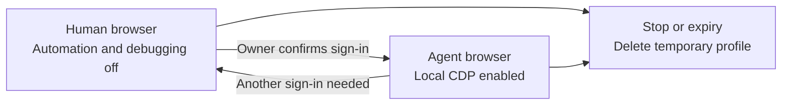

# remote-gui

Share a task-local app through private Tailscale HTTPS, or give a human control of a fresh headed Chromium browser. Human sign-in runs with automation and browser debugging disabled. After the owner confirms completion, the agent can resume in the same disposable profile. Tailscale access opens directly for the selected owner's identity, with no viewer password or enrollment step.

## Install and activate

Install `remote-gui` independently from the vhco-tools marketplace. For Claude Code:

```sh
claude plugin marketplace add michielvha/vh-adlc
claude plugin install remote-gui@vhco-tools
```

In Codex desktop, add `michielvha/vh-adlc` as a marketplace and select `remote-gui` under Personal. Start a new chat so the skill is discovered. Runtime users do not need vh-adlc.

Automatic remote links need a persistent instruction in the owner's normal agent startup instructions. With the owner's authorization, add this snippet in the startup instructions they select:

```text
The human uses this host remotely over Tailscale. Before sending a human-facing
local app or preview URL, load and follow the installed remote-gui skill and
provide its verified tailnet URL. Do this on the first link without a reminder.
Keep external URLs unchanged and internal CDP/auth callback URLs local. Use a
loopback route only for an explicitly established SSH tunnel. If forwarding or
required browser verification fails, report the blocker without a localhost fallback.
```

Installation makes the plugin discoverable. Activation establishes remote context for future chats. Native-agent scenarios and a browser on the other device establish actual behavior; package discovery alone does not.

Version 0.2.0 adds human and agent browser phases. Update the installed marketplace plugin through your agent's plugin manager, then start a new chat to load its instructions. Existing sessions retain their running supervisor's code. End an older session before using the updated phase workflow.

## Human sign-in and agent hand-back



Use human mode for an unfamiliar login or MFA. Keep the connection tab open and open the authorized website in a new tab inside the shared browser. The agent pauses input while the owner signs in. After confirmation, `handoff` gracefully closes only the owned Chromium process and relaunches it with native session restoration. Tabs, session cookies and tab-scoped storage remain in that session's profile. The viewer URL, expiry, display and pinned owner stay fixed.

Ordinary inspection and non-login forms can start in agent mode. A later credential challenge requires a transition to human mode before entry. Legacy `start` and records without a mode retain agent behavior.

A failed handoff preserves the viewer and profile until stop or expiry. Its diagnostic may require the owner to finish closing a browser window or resolve a profile lock before retrying. Require `ready` and the intended `browser_mode` before continuing. The reported mode on a failed transition is the last completed phase. Never delete locks or force a second browser into the profile.

Provider acceptance remains a separate check. If a provider rejects a genuine human browser, use its supported authentication route or keep that task human-only. Initial side-effect-free `ERR_NETWORK_CHANGED` navigation allows two retries in the same session. Credential submissions and provider rejections require a separate recovery decision.

## Clipboard panel

The **Clipboard** button in the browser viewer opens the clipboard panel. Text moves between the owner's device and the remote clipboard, the CLIPBOARD selection of the shared browser's display, only when the owner presses one of its buttons.

1. To send text, paste it into **Text for the remote browser** with the device's normal paste gesture, then press **Send to remote browser**. Press Ctrl+V in the remote page to paste it there.
2. To bring text back, copy it in the remote browser, then open the panel or press **Refresh**. **Copied in the remote browser** shows the text, unmasked, with its character count. Press **Copy to this device** to put it on the device's clipboard.
3. **Clear** empties both panel areas and the remote clipboard.

The panel shows whether the human or the agent controls the shared browser, as of its latest clipboard request. In agent mode it warns that sent text is readable by the agent, and every send confirmation names the mode. A send is refused while the browser is switching modes, or when the mode has changed since the panel showed it. The panel then shows the current mode and keeps the text in the field.

Text up to 64 KiB moves in either direction, including characters outside Latin-1. Larger text is refused with a message in the panel. The panel carries plain text only: no files, images or formatting, and not the PRIMARY selection used by middle-click paste.

The page never reads the device's clipboard. Pasting into the field uses the device's own paste and needs no permission. **Copy to this device** writes the clipboard only inside that click, which Chromium and Firefox allow without a prompt on the HTTPS tailnet origin and on a `127.0.0.1` loopback origin. If the browser still blocks the write, the panel selects the text and asks the owner to copy it with the device's shortcut.

Privacy and clearing rules:

- Clipboard text exists only in the viewer page's memory and in the supervisor's memory while it holds the remote clipboard. It never enters state records, diagnostics, command output or logs.
- The page empties the panel after a send, on **Clear**, when the viewer disconnects or the page closes, and when the session ends. The send field is kept out of the browser's session-restore files; this is verified for Chromium and Firefox viewers only.
- Every handoff to agent mode clears the remote clipboard, the PRIMARY selection and the root window's cut buffer after the human browser closes, and checks that all three are empty before the agent's browser starts. If the check fails, the handoff ends in `handoff-failed` with a `clipboard-` diagnostic and no agent browser, and a retry clears again. A handoff to human mode does not clear.
- x11vnc runs with its own selection handling turned off, so only the supervisor's built-in clipboard helper changes the remote clipboard.

## Existing host tools

The runtime supports Linux amd64 and the Go version declared in `go.mod`. The Bash helper builds the complete installed module in a private source-keyed cache with `GOTOOLCHAIN=local`, module downloads disabled and VCS stamping disabled. It works outside a Git checkout. If PATH selects an older Go launcher, set `REMOTE_GUI_GO` to the existing matching executable. Nothing is downloaded.

Service sharing needs no GUI tools. Tailscale mode needs an existing signed-in installation, tailnet HTTPS, conditional LocalAPI ETag/If-Match updates and authorization to manage Unix-backed Serve targets. `doctor` reads capabilities and the selected owner; it cannot prove write permission without a mutation. A missing owner or unsupported peer/Unix capability blocks startup. The tool never switches to an identity-trusting TCP backend.

If this host needs local operator setup, its administrator must authorize it separately. The plugin never runs sudo, changes the operator or enables Funnel automatically. Existing routes and unknown configuration fields are preserved with conditional updates; reset and whole-config restoration are forbidden.

Browser mode also needs existing Xvfb, xauth, x11vnc, websockify, Chromium with a working sandbox, and noVNC assets:

| Variable | Default |
| --- | --- |
| `REMOTE_GUI_XVFB` | `Xvfb` on PATH |
| `REMOTE_GUI_XAUTH` | `xauth` on PATH |
| `REMOTE_GUI_X11VNC` | `x11vnc` on PATH |
| `REMOTE_GUI_WEBSOCKIFY` | `websockify` on PATH |
| `REMOTE_GUI_CHROMIUM` | `chromium-browser` on PATH |
| `REMOTE_GUI_NOVNC` | `/usr/share/novnc` |
| `REMOTE_GUI_TAILSCALE_SOCKET` | `/run/tailscale/tailscaled.sock` |

Use distribution packages or verified existing user-cache installations. `doctor` reports missing-tool guidance. The runtime does not install packages or edit global MCP configuration. noVNC must include its `core` and `vendor` assets.

## Commands

From the installed plugin directory, run `bash scripts/remote-gui.sh` (abbreviated below as `remote-gui`). Output is JSON with schema version 1. Default lifetime is two hours, maximum eight hours.

```sh
remote-gui doctor --kind share --transport tailscale
remote-gui share http://127.0.0.1:3000/preview --ttl 2h
remote-gui doctor --kind browser --browser-mode human --transport tailscale
remote-gui start --browser-mode human --ttl 2h
remote-gui handoff <session-id> --browser-mode agent
remote-gui handoff <session-id> --browser-mode human
remote-gui status
remote-gui status <session-id>
remote-gui access <session-id> --reveal
remote-gui stop <session-id>
remote-gui cleanup
```

Tailscale sessions pin one exact owner login at creation. The default is the active host profile's user. Use `--owner-login human@example.com` on `doctor`, `start` or `share` when trusted task context selects another account, or the host profile is tagged. A tagged or unavailable default identity requires this explicit value. Status/access cannot change the owner afterward. No wildcard or whole-tailnet fallback is accepted.

Tailscale access metadata reports `auth_mode: tailscale-identity`, the pinned `owner_login`, URL and `expires_at`. `access --reveal` includes the complete intended app query but never issues a Tailscale viewer code or enrollment deadline. Ordinary output omits app queries. The owner opens the direct URL on their connected Tailscale device; no username/password dialog or **Open session** step appears. A missing, tagged or different viewer identity receives HTTP 403.

Identity headers are trusted only on the session's private Unix socket from the exact daemon process pinned through kernel peer credentials and process-birth metadata. Caller-supplied identity headers on a TCP connection or from another Unix client grant no access. A daemon restart requires a new session. Tailscale authenticates the device's user identity, so processes on an allowed owner's device share that network authority; this is not a separate per-browser login.

`ready` attests host transport probes. The skill must check the intended app, assets, redirects, cookies, origin behavior and required WebSockets before advertising a usable link. A failed or unavailable required browser check reports `compatibility-blocked` and stops sharing while preserving the app. Apps needing script-readable cookies, their own Authorization/HTTP authentication, or workers remain unsupported. Server-managed app cookies use temporary per-share, per-client jars. Raw browser cookies, Tailscale identity headers and internal probe proofs never reach the app.

Service shares pin one unambiguous listener and its process birth identity. Each new upstream connection must also have an accepted socket owned by that process before request bytes are sent. A missing, changed or unverifiable connection blocks sharing. Servers that transfer accepted sockets to another process are unsupported by this identity check.

State defaults to `$XDG_STATE_HOME/remote-gui/sessions` or `~/.local/state/remote-gui/sessions`. `REMOTE_GUI_HOME` or `--home` selects a short absolute private directory. Directories use 0700 and files/sockets use 0600. `REMOTE_GUI_BUILD_CACHE` selects a private build cache. Stopping a browser deletes its temporary profile and downloads; stopping a service share preserves its app process, files and settings.

Syntax errors exit 2; operation failures exit 1. Missing status/access fails. Repeated stops exit 0; an unknown ID returns `state: missing`. States are starting, ready, handoff, handoff-failed, stopping, stopped, failed and cleanup-pending. `diagnostic` preserves the primary failure; `cleanup_diagnostic` reports unresolved cleanup separately. Cleanup retains its record and denial listener when scoped removal fails. Changed mappings or socket paths remain untouched. Resolve the blocker and rerun cleanup.

## Viewer context and explicit SSH

Use a fresh isolated private viewer context for each session, with previous remote-gui private contexts closed. A new tab alone is insufficient. This shared-host version cannot repair an older tab or service worker that previously controlled the same origin. New workers are blocked. Chromium and Firefox flows are exercised by optional browser checks. Random marker entry is an acceptance-test procedure; the agent verifies its browser automatically during ordinary handoff.

SSH is an explicit optional transport, never a fallback for a Tailscale failure. For an owner-established tunnel, use `--transport loopback`, forward the same viewer port with `ssh -N -L <port>:127.0.0.1:<port> <host>`, and use the selected `127.0.0.1` browser origin. The plugin does not configure SSH.

Only loopback access uses username `viewer` and a one-time code from `access <id> --reveal`. Open **Open session** in a fresh private context and enter that code in the native browser authentication prompt. It is not a provider password. Enrollment expires after ten minutes or session expiry and redeems once; a new code invalidates its unredeemed predecessor. Later requests require both the native credential and non-bearer HttpOnly binding. Keep codes out of URLs, repositories, logs and traces.

## auth-refresh

Use auth-refresh for configured CLI/SSO identities. It retains ownership of accounts, credentials and browser lanes. Remote-gui never reads that state or copies cookies. An active challenge must finish or safely yield through its owning workflow before another challenge starts. Unknown-credential logins and non-login forms/inspection can use a fresh remote-gui browser. Sharing a browser never proves CLI authentication success or authorizes later provider actions.

Read the [skill](skills/remote-gui/SKILL.md) for capability checks, input pause and exact-session resume.
